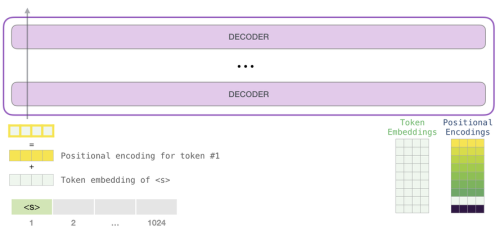
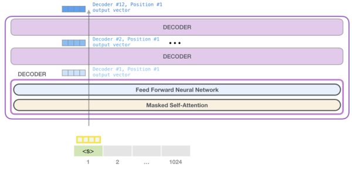
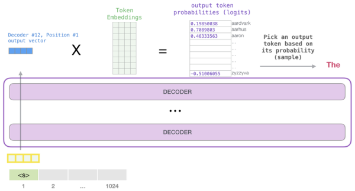

1. language modeling
- only has one stack of transformer blocks

2. auto regression
- after each token is produced, that token is added to sequence of inputs

3. generating unconditional samples
3.1. input encoding
- look up embedding of word in embedding matrix
- use positional encoding matrix to get input vector

3.2. move up stack

- self-attention
- FFNN

3.3. model output
- output of top block is multiplied with embedding matrix

sources:
<https://jalammar.github.io/illustrated-gpt2/>