1. transformer
- contains multiple encoders and decoders
- encoders are identical in structure, but do not share weights

2. encoder
- broken down into: self-attention -> feed forward neural network
- self-attention layer: helps encoder look at other words in the input sentence 
- same feed forward neural network is independently applied to each position

3. decoder
- has same layers as encoder, but with another attention layer
- self-attention -> encoder-decoder attention -> feed forward neural network

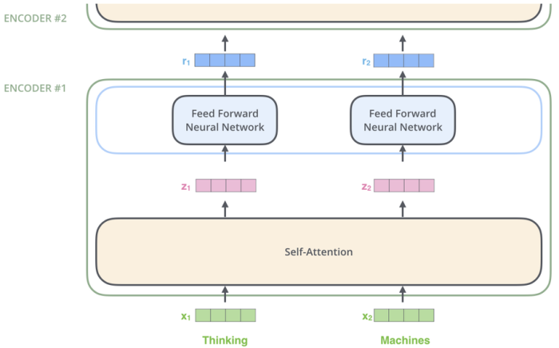

4. calculating self-attention with vectors
4.1. create three vectors from each of the encoder's input vector
- input vector =(* matrix)=> query vector, key vector, value vector
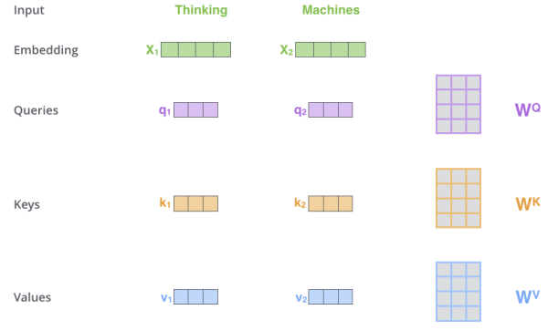
4.2. calculate score
- score determines how much focus to place on other parts of the input sentence as we encode a word at a certain position
- query vector * key vector of word to score => score
4.3. divide scores by 8
- 8 is the square root of the dimension of the key vectors used in the paper, attention is all you need
4.4. pass result through softmax operation
4.5. multiply each value vector by softmax score
- drown out irrelevant words
4.6. sum weighted value vectors
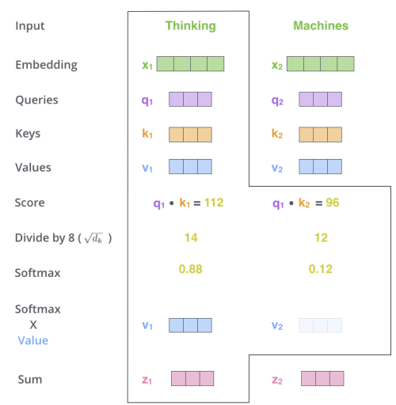

5. calculating self-attention with matrices
5.1. calculate query, key, value matrices
- pack embedding into matrix X
- multiply X with weight matrices
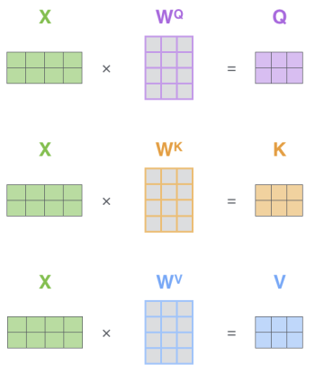
5.2. calculate output
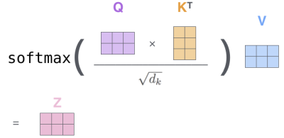

6. multi-headed attention
- improves performance in two ways:
   - expands model's ability to focus on different positions
   - gives attention layer multiple "representation subspaces"
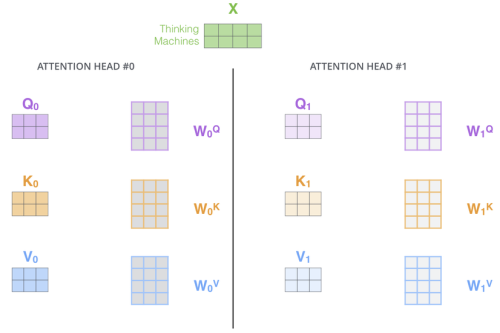
- output matrices of each head is concatenated and multiplied with an additional weight matrix to condense matrix for FFNN

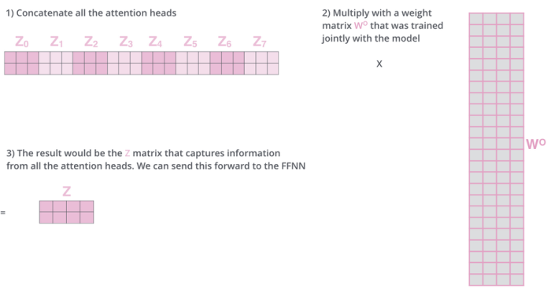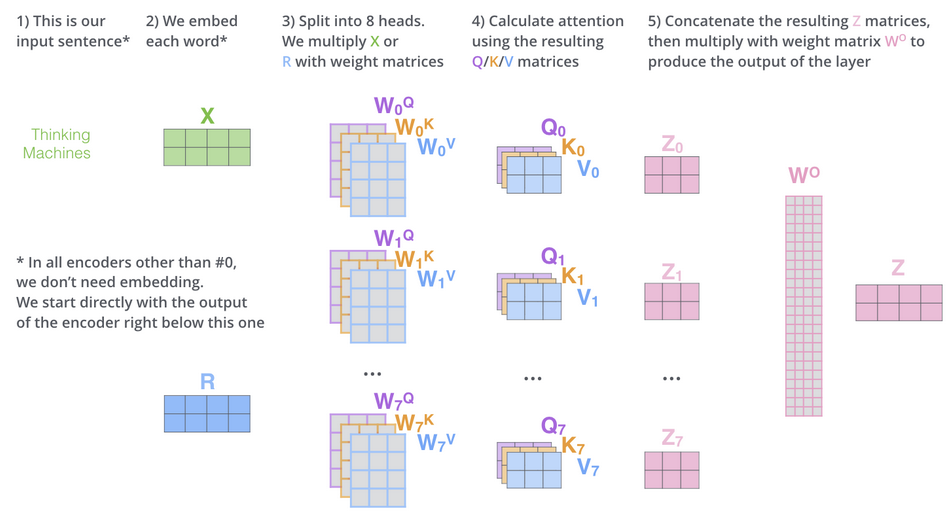

7. positional encoding
- these vectors help determine the position with each word
- adding these values to embeddings provides meaningful distances between embedding vectors once projected into Q/K/V vectors and during dot-product attention

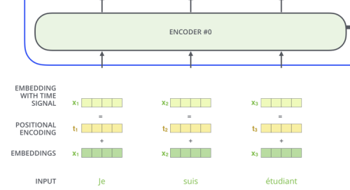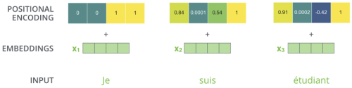
real example of positional encoding with a toy embedding size of 4

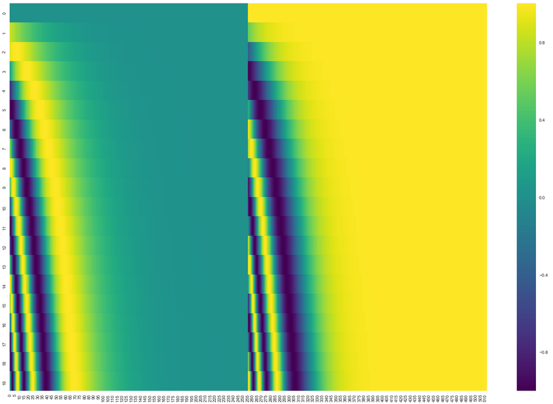
real example of positional encoding for 20 words (rows)

8. residuals
- each encoder sub-layer has a residual connection, and is followed by a layer-normalization step

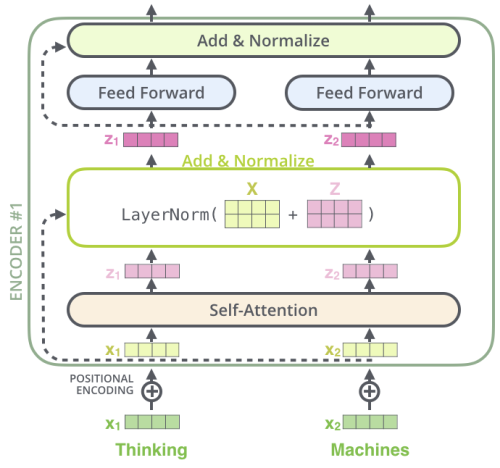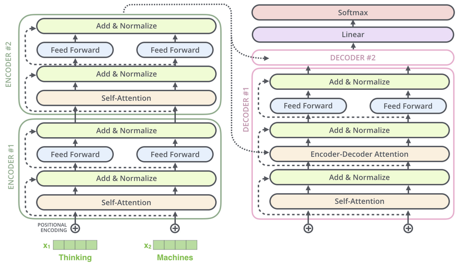

9. decoder
- output of top encoder is transformed into set of attention vectors K and V
- K and V are used by each decoder in its encoder-decoder attention layer => helps decoder focus on appropriate places in the input sequence
- output of each step is fed to bottom decoder in the next time step
- embed and add positional encoding to decoder inputs
- self-attention layer is only allowed to attend to earlier positions in the output sequence (masked self-attention)
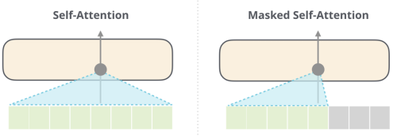
- encoder-decoder attention layer works like multiheaded self-attention, but with queries matrix from layer below and keys and values matrix from output of encoder stack

10. final linear layer
- fully connected neural network 
- projects vector produced by stack of decoders into a much larger vector called logits vector
- logits vector has 1 cell for each known unique word
- each cell contains score of corresponding word

11. softmax layer
- turns scores into probabilities

source:
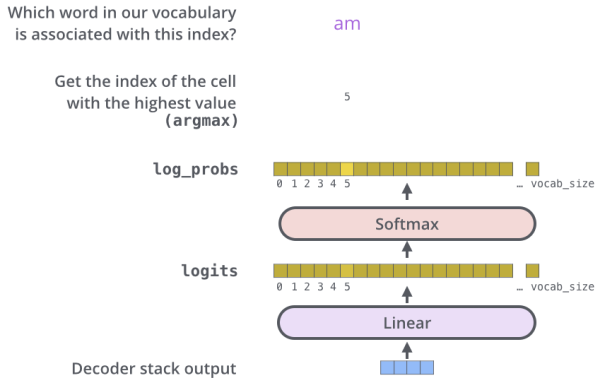<https://jalammar.github.io/illustrated-transformer/>