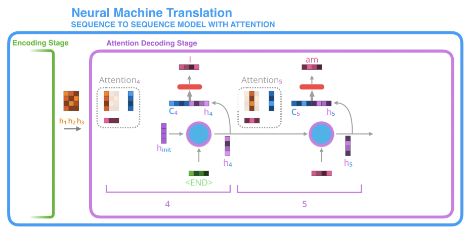
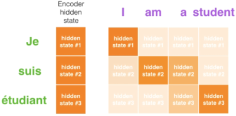

1. sequence to sequence model
- composed of encoder and decoder => both are usually RNNs

2. encoder
- compiles information into vector (context)

3. context
- basically the number of hidden units in the encoder
- word embedding algorithms are used to transform words into vectors
- turned out to be bottleneck

4. attention
- encoder passes all hidden states to decoder instead of just the last hidden state
- decoder has an extra step to produce output:
   - give each hidden state a score
   - multiply each hidden state by its softmaxed score
- attention process (repeat for each time step):
   - decoder takes in embedding of the <END> token and initial decoder hidden state
   - process inputs => output and new hidden vector state, h4
   - encoder hidden states + h4 vector => context vector, c4
   - h4 and c4 concatenated to one vector
   - vector =(feedforward neural network)=> output word

source:
<https://jalammar.github.io/visualizing-neural-machine-translation-mechanics-of-seq2seq-models-with-attention/>

further reading:

seq2seq model paper 1: <https://papers.nips.cc/paper/5346-sequence-to-sequence-learning-with-neural-networks.pdf>
seq2seq model paper 2: <http://emnlp2014.org/papers/pdf/EMNLP2014179.pdf>
intro to RNN: <https://www.youtube.com/watch?v=UNmqTiOnRfg>
word embedding algorithm: <https://machinelearningmastery.com/what-are-word-embeddings/>