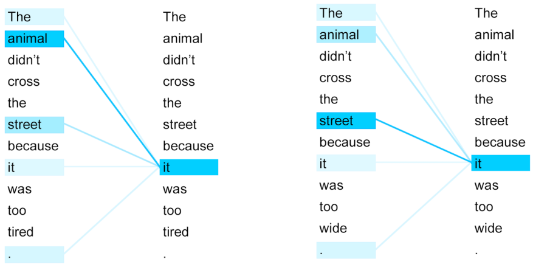
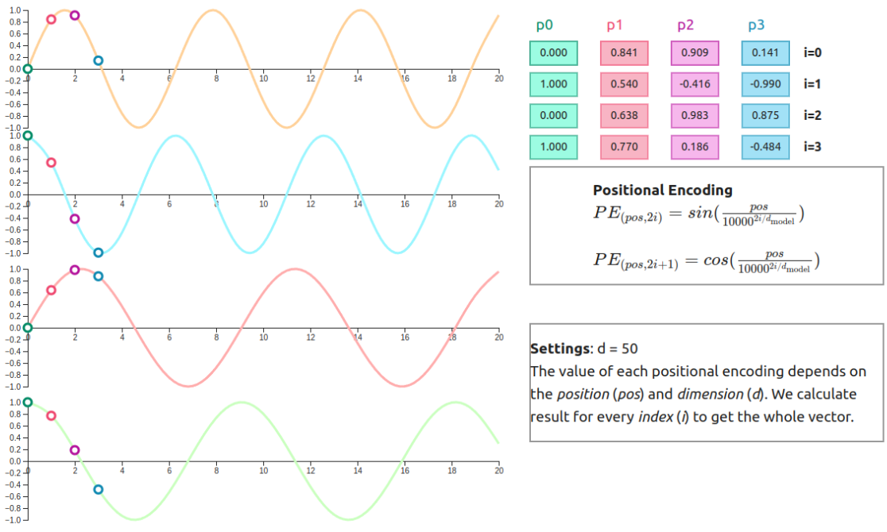

1. transformer

2. core concept - self attention
- attention compares target word to translate with input sentence
- compares words within input sentence to see how they relate

3. core concept - parallelization 
- unlike RNN, can process all words in sentence in parallel
- allows model to be much quicker

4. core concept - positional encoding
- used to keep order between words
- using simple indices means values can increase indefinitely, causing confusion in model
- normalizing to values between 0 and N changes distance between words, not allowing it to learn absolute distances 
- using sin and cos:
   - keeps values between -1 and 1 (bounded)
   - due to the cyclic nature, even a new position is not confusing for the model (extrapolation)
   - x + k encoding is a linear transformation of x encoding; allows model to learn relationship easily 
   - combining different frequencies in a single vector allows each position to have a unique "fingerprint"

reference:
- 가천대 인공지능입문 Lecture 5 강의 자료 