1. Perceptron
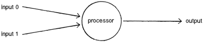
- simplest first-gen neural network
- algorithm:
   - multiply each input by its weight
   - sum weighted input
   - apply activation function to get output

2. modified Perceptron
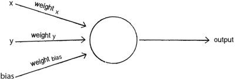
- bias input is added
- can solve OR

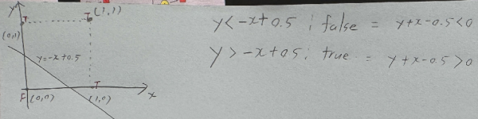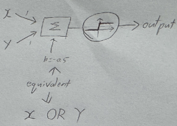
- can solve AND
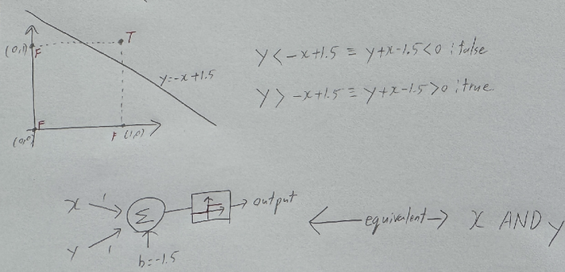

3. training Perceptrons
- compute error and adjust weights according to error (gradient descent)

4. Perceptron limitations
- can only solve linearly separable problems
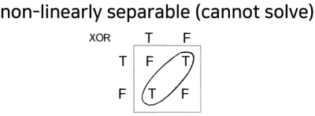

5. Artificial Neural Network (ANN)
- network of perceptrons
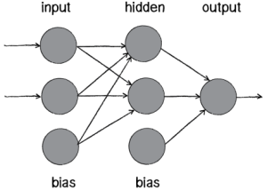
- solves problems perceptrons can't - [1]

6. common activation functions
- unit step function
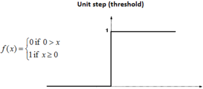
- piecewise linear
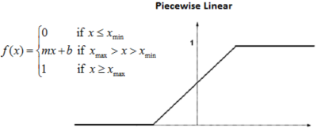
- Rectified Linear Unit
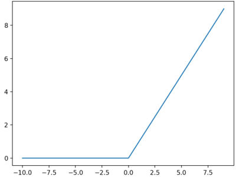
- Sigmoid
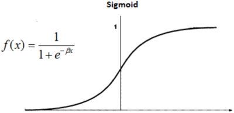
- Softmax (hyper-tangent)
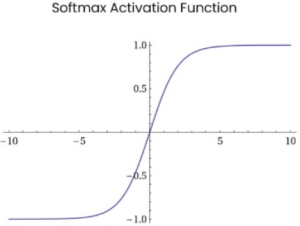
- Gaussian Function
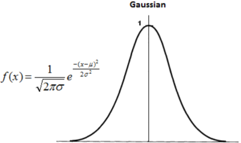

7. ANN problems
- not appropriate for precise calculations
- training takes time and data
- determining network architecture is difficult (node count, layer count)
- no explanation for results

8. backpropagation
- calculate error for each neuron in the output layer
- using error, calculate changes to the weights in each neuron in hidden layer
- errors cannot be directly calculated for hidden neurons since they don't have target output => errors are backpropagated

   - Error~B~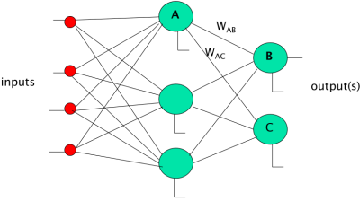 = Output~B~*(1-Output~B~)(Target~B~ - Output~B~)
      - output(1-output) is derivative of sigmoid function
   - W~AB~ := W~AB~ + (Error~B~ * Output~A~)
   - ErrorA = Output~A~ (1 - Output~A~)(Error~B~ W~AB~ + Error~C~ W~AC~)

9. backpropagation demonstration
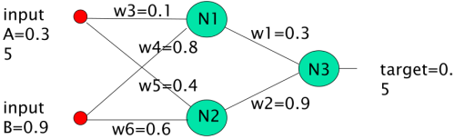
- new weights for output layer:
   - w1+ = w1+(δ x input) = 0.3 + (-0.0406x0.68) = 0.272392
   - w2+ = w2+(δ x input) = 0.9 + (-0.0406x0.6637) = 0.87305
- Errors for the hidden layer:
   - δ1 = δ x w1 = -0.0406 x 0.272392 x (1-o)o = -2.406x10-3
   - δ2= δ x w2 = -0.0406 x 0.87305 x (1-o)o = -7.916x10-3
- New hidden layer weights:
   - w3+=0.1 + (-2.406 x 10-3 x 0.35) = 0.09916
   - w4+ = 0.8 + (-2.406 x 10-3 x 0.9) = 0.7978
   - w5+ = 0.4 + (-7.916 x 10-3 x 0.35) = 0.3972
   - w6+ = 0.6 + (-7.916 x 10-3 x 0.9) = 0.5928
- new error becomes -0.18205

10. types of neural networks
- Perceptron
- feed forward
- deep feed forward
- Radial Basis Function (RBF) network
- Recurrent Neural Network (RNN)
- Long/Short term memory (LSTM)
- Auto-Encoder (AE)
- Convolutional Neural Network (CNN)
- Generative Adversarial Network (GAN)
- Transformer

reference:
- Gachon University - Machine learning lecture

notes
[1]: combine 3 AND perceptrons
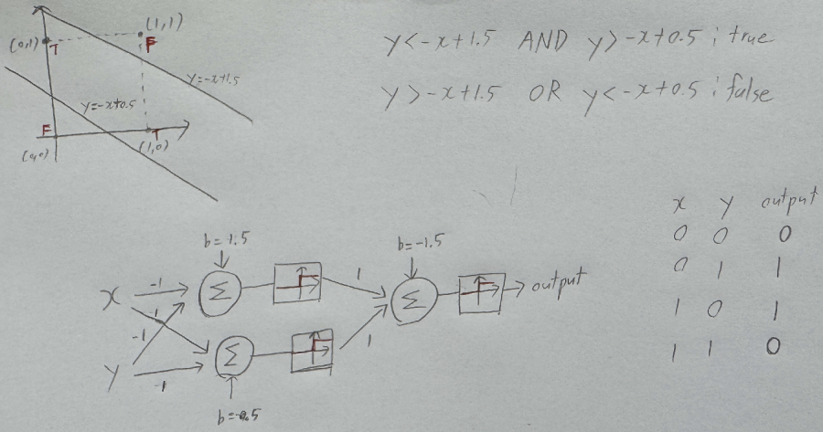