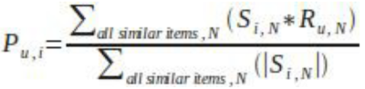
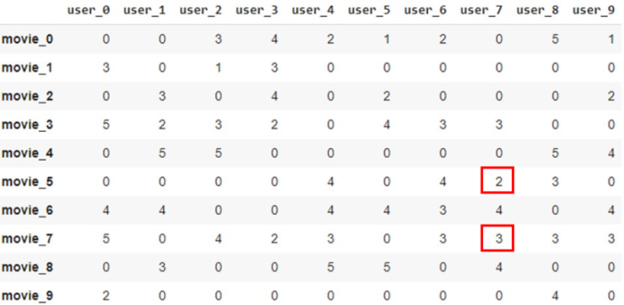

1. item-based CF
- recommendations are made by finding items that have similar appeal to many users

2. steps
- identify set of items rated by target user
- identify set of N items most similar to target item
- generate rating prediction based on set of similar items

3. computing item similarity
- find users who have rated both items
- apply similarity function to ratings (usually cosine-based similarity)

4. computing predictions
- multiple techniques available
- e.g. weighted sum


5. demonstration
- replace missing values with 0


- compute similarity and neighbors

```python
from sklearn.neighbors import NearestNeighbors
knn = NearestNeighbors(metric='cosine', algorithm='brute')
knn.fit(df.values)
distances, indices = knn.kneighbors(df.values, n_neighbors=3)
print(indices)
print(distances)
array([[0, 7, 5],
[1, 3, 7],
[2, 1, 6],
....
[9, 0, 7]])
array(
[[0.00000000e+00, 3.19586183e-01, 4.03404722e-01],
[4.44089210e-16, 3.68421053e-01, 3.95436458e-01],
[0.00000000e+00, 5.20766162e-01, 5.24329288e-01],
....
[1.11022302e-16, 4.22649731e-01, 4.81455027e-01]])
```

movies 7 and 5 are closest to movie 0 with similarities 3.195... and 4.034...

- predict rating for movie 0 by user 7
R(0,7) = (S(0,5)∗R(5,7)+S(0,7)∗R(7,7))/(S(0,5)+S(0,7))
= ((1 - 0.4034)*2 + (1 - 0.3196)*3)/(1 - 0.4034 + 1 - 0.3196)
= 2.5328

6. item-based CF advantages
- more accurate than user-based
- performs better than user-based

7. item-based CF disadvantages
- may recommend items that aren't novel from previous user experience

reference:
- Gachon University - Machine learning lecture