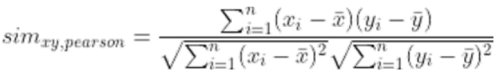
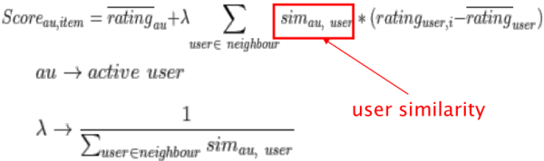
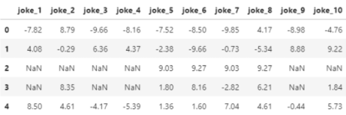
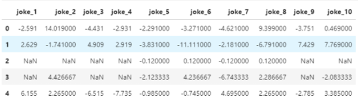
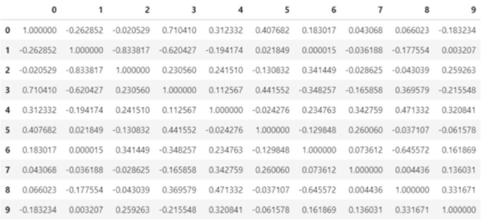
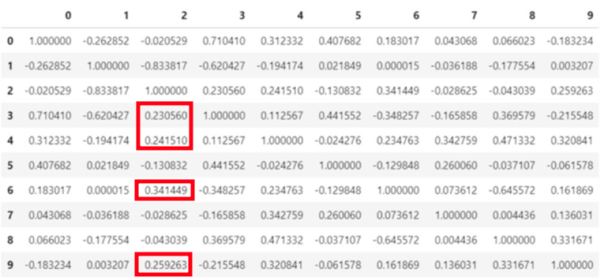
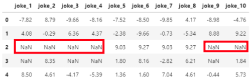
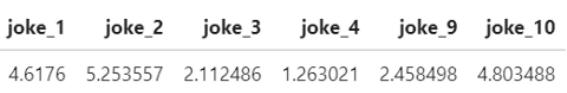

1. user-based CF
- recommendations are made by finding users with similar preferences

2. steps
- normalize data
- calculate user similarities
   - identify users who rated items that target user rated
   - Pearson correlation used often to calculate similarity score
	
- determine nearest neighbor users
   - methods
      - use all data
      - select data above similarity threshold (below minus threshold can be utilized as well for negative impact)
      - select top N data by similarity
      - select similar cluster using clustering method
- calculate item scores
   - identify users who rated items not rated by target user
   - for each item generate rate prediction via weighted average
	
	(adjust target's average by the weighted sum of deviations by similar users from their average)
- determine item(s) to recommend

3. demonstration - [1]

- normalize data

- compute user similarity

- select neighbors of user2 (threshold +0.1)

users 3, 4, 6, 9

- identify items not rated by target user

joke 1, 2, 3, 4, 9, 10

- predict item scores

- choose items using score

4. user-based CF advantages
- doesn't require information about users and items
- easy to implement

5. user-based CF disadvantages
- doesn't perform well when ratings matrix has a large number of users
- doesn't perform well when ratings matrix is sparse
- user similarity can't be calculated for new users (cold start)

reference:
- Gachon University - Machine learning lecture

notes:
[1]: view Machine Learning lecture notes for python code