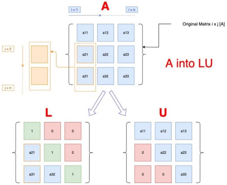
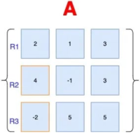
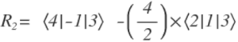
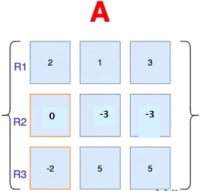
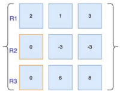
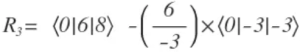
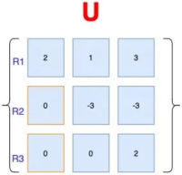
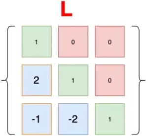

1. LU decomposition

L:
- lower triangular matrix
U:
- upper triangular matrix

2. demonstration

- divide a~21~ by a~11~ and multiply with R1. Subtract it from R2

multiplier: 2

- replace a~31~ the same way
R~3~ = <-2|5|5> - (-2/2)*<2|1|3>

multiplier: -1

- replace a~32~ the same way

multiplier: -2

- L matrix use multipliers from the U matrix in the same indices

reference:
- Gachon University - Machine learning lecture