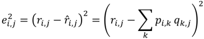
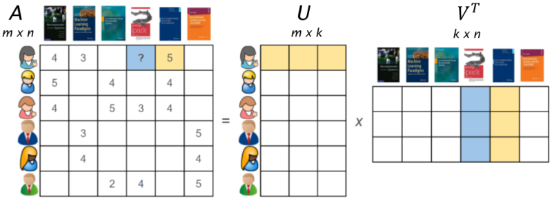
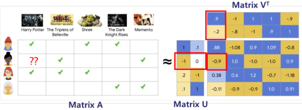

1. matrix factorization
- an approximation of SVD
- considered one of the best single-model approach to CF
- prediction for user~i~ for item~j~ (r~ij~) can be obtained as dot product of U~i~ and V^T^~j~
- objective(loss) function must be minimized using various algorithms

2. matrix factorization visualized

A: 
- user-item matrix
U:
- user latent matrix
- row i is called embedding for user i
V^T^:
- item latent matrix
- row j is called embedding for item j

3. demonstration

