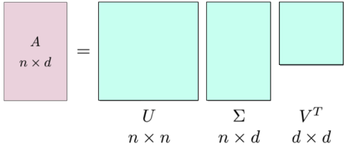
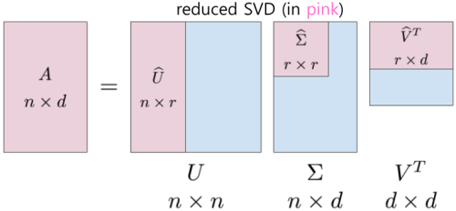
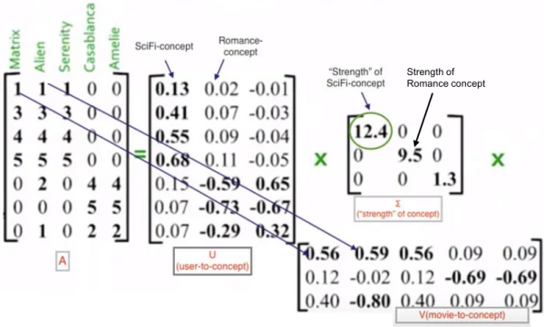

1. SVD
- requires missing values to be filled
- models users and items as vectors of latent features whose cross product produces the rating for the user of the item
- ratings matrix is refactored into a series of linear approximations that expose the set of principal components (latent factors that explain observed ratings
- reduces dimensionality of ratings matrix
- applications
   - Principal Component Analysis (PCA)
   - signal processing (image compression, noise reduction, etc)

2. visualization

A: input matrix
U:
- left orthogonal matrix of A
- eigenvectors of AA^T^
- contains information about row
- each column is a singular value vector
- represents rotation
Σ:
- diagonal matrix of latent factors
- represents scaling of singular values along different coordinates
V^T^:
- right orthogonal matrix of A
- eigenvectors of A^T^A
- contains information about column
- each row is a singular value vector
- represents rotation of unit disk

choose r so that it contains more than 90 percent of the information

items are converted to "concepts"

3. important notes
- names of concepts are made by human experts after examining matrices
- "concepts" are latent factors
- the matrices look strange because they represent the original data projected onto different coordinates

reference:
- Gachon University - Machine learning lecture