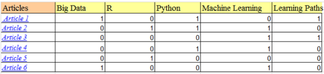
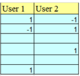
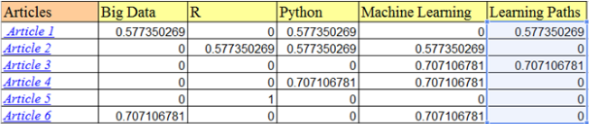
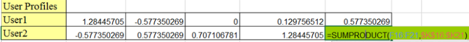
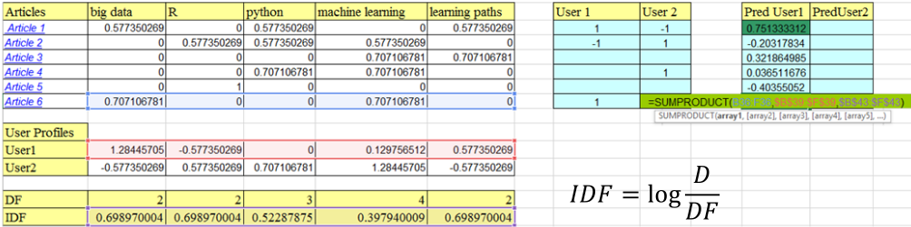

1. content-based filtering
- recommend items that are similar to ones user liked
- requires "content", i.e. information about users and items
- uses machine learning models

2. demonstration

- normalize items matrix by dividing occurrence by square root of number of attributes - [1]

- generate user profiles via sum product

- sum product user vector with item vector and IDF vector

3. advantages
- no cold start
- no sparsity problems
- no need for data on other uses
- able to recommend unique tastes
- able to recommend new and unpopular items
- can provide explanation of recommended items - [2]

4. disadvantages
- requires content to be encoded as meaningful features
- users' tastes must be represented as learnable function
- unable to exploit quality judgement of other users

reference:
- Gachon University - Machine learning lecture

notes
[1]: square root is used because having 2 times as many attributes doesn't make each weigh 2 times as less
[2]: list content-features that caused item to be recommended