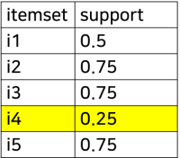
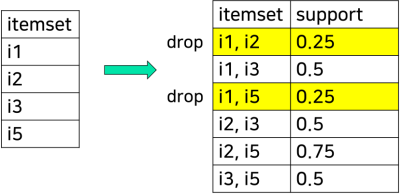
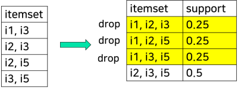
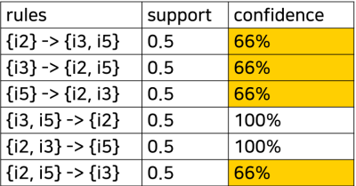

1. Apriori
- rules originating from same itemset have same support => consider only frequent itemsets
- may generate a large number of candidate itemsets
- requires many scans of database

2. generating frequent itemsets
- get minimum support threshold
- generate a list of one-itemset
- prune items that don't meet threshold
- generate list of two-itemset
- prune
- repeat until k-itemset is pruned

3. walkthrough

| TID | items |
| --- | --- |
| T1 | i1, i3, i4 |
| T2 | i2, i3, i5 |
| T3 | i1, i2, i3, i5 |
| T4 | i2, i5 |

- support threshold: 50%
- confidence threshold: 80%
- k = 3
- one-itemset pruning

drop i4

- two-itemset pruning

- three-itemset pruning

- generate candidate rules from itemset and prune

reference:
- Gachon University - Machine learning lecture