1. FP growth
- grow long patterns (itemsets) from short ones using local frequent items => avoid generating candidate itemsets
- advantages:
   - 2 database scans
   - smaller memory requirement compared to apriori
   - fast time due to absence of candidates

2. FP growth stage 1: FP tree construction
- step 1: 
   - construct 1-itemset
   - prune
   - create f-list
   - sort items in table in frequency-descending order
- step 2:
   - construct FP tree
   - construct header table

3. FP growth stage 2: mine conditional FP trees
- step 1:
   - find every frequent item X on FP tree by following linked list
   - for each occurence of X, accumulate all direct ancestors of X
   - construct conditional FP tree from each conditional pattern base
- step 2: mine conditional FP tree recursively

4. walkthrough
- construct 1-itemset
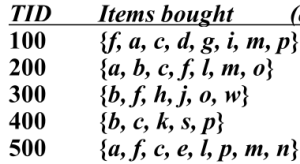

- create f-list where min support = 3
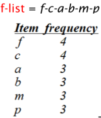

- sort
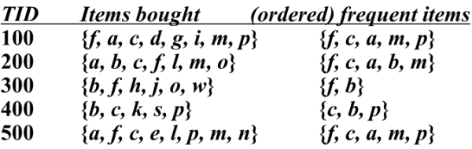

- construct FP tree
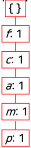 => 	=> 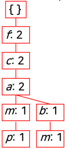 => 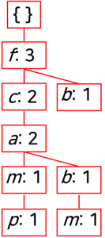 => 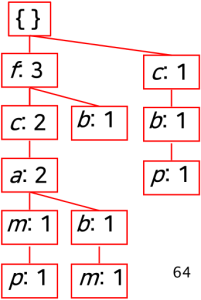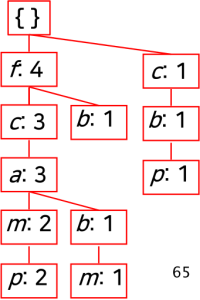

- construct header table
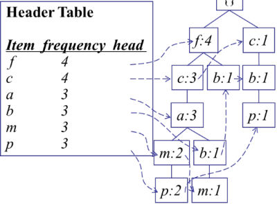

- create conditional pattern bases
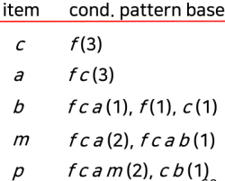

- construct conditional FP trees (e.g. m):
   - m-conditional pattern base: fca(2), fcab(1) => fff ccc aaa b
   - prune 
   - create m-conditional FP tree
	

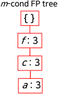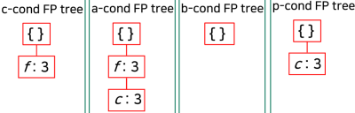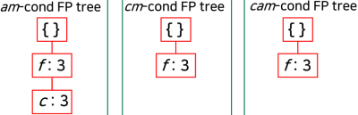

- mine conditional FP trees
 => 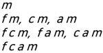

- generate association rules
- prune

reference:
- Gachon University - Machine learning lecture