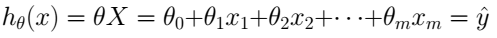
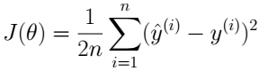
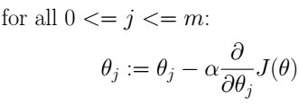
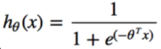
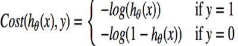
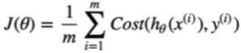
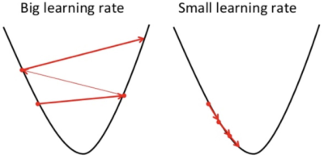
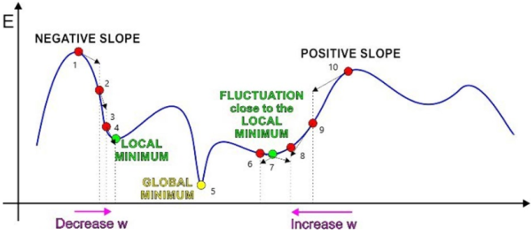
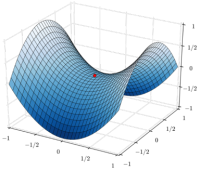
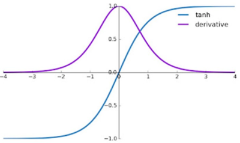

1. simple linear regression
- hypothesis

- cost function

- minimizing J(θ) is the goal

2. logistic regression
- hypothesis

- loss function

- cost function

- minimizing cost function is the goal

3. learning rate α

- automatically chosen with
   - Adam optimizer
   - AdaGrad
   - RMSProp

4. challenges
- computation time
- control learning rate => speed up convergence + minimize oscillations near local/global optima

- non-convex cost functions to optimize (i.e. saddle points)

- vanishing gradients
   - solution: use ReLU as activation function

5. variations
- batch gradient descent
   - compute gradient with entire training data
   - very slow
- stochastic gradient descent
   - compute gradient with single training data
   - much faster
- mini-batch gradient descent
   - compute gradient with small mini-batch

reference:
- Gachon University - Machine learning lecture