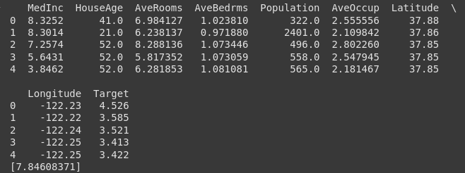

dataset: <https://scikit-learn.org/stable/modules/generated/sklearn.datasets.fetch_california_housing.html#sklearn.datasets.fetch_california_housing>

```python3
import numpy as np
from sklearn import datasets
from sklearn.linear_model import LinearRegression
import matplotlib.pylab as plt
import pandas as pd

house_prices = datasets.fetch_california_housing()
df = pd.DataFrame(house_prices.data, columns=house_prices.feature_names)
df['Target'] = house_prices.target
print(df.head())
model = LinearRegression()
model.fit(house_prices.data, house_prices.target)
y_pred = model.predict([[10, 2.0, 30.0, 10.0, 5000.0, 3.0, 37.81, -122.28]])
print(y_pred)
```

