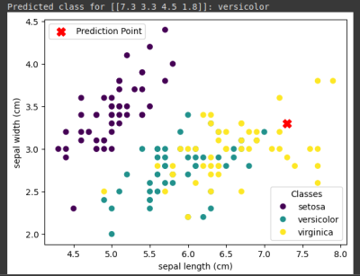

dataset used: <https://scikit-learn.org/1.4/auto_examples/datasets/plot_iris_dataset.html>

```python3
import numpy as np
from sklearn.neighbors import KNeighborsClassifier
from sklearn import datasets
import matplotlib.pylab as plt

iris = datasets.load_iris()
model = KNeighborsClassifier(n_neighbors=5)
model.fit(iris.data, iris.target)

# The data point we want to predict and plot
prediction_point = np.array([[7.3, 3.3, 4.5, 1.8]])
y_pred = model.predict(prediction_point)
print(f"Predicted class for {prediction_point}: {iris.target_names[y_pred][0]}")

_, ax = plt.subplots()

# Plot the training data
scatter = ax.scatter(iris.data[:, 0], iris.data[:, 1], c=iris.target)

# Plot the prediction point with a distinct marker and color
ax.scatter(prediction_point[:, 0], prediction_point[:, 1], c='red', marker='X', s=100, label='Prediction Point')

ax.set(xlabel=iris.feature_names[0], ylabel=iris.feature_names[1])

# Add a legend for the training data
legend1 = ax.legend(
    scatter.legend_elements()[0], iris.target_names, loc="lower right", title="Classes"
)
# Add the first legend to the axes
ax.add_artist(legend1)

# Add a legend for the prediction point
handles, labels = ax.get_legend_handles_labels()
ax.legend(handles[-1:], labels[-1:], loc="upper left")

plt.show() # Display the plot
```

