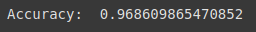

dataset: <https://www.kaggle.com/datasets/uciml/sms-spam-collection-dataset/data>

```python3
# -*- coding: utf-8 -*-
"""spam_email_detector.ipynb

Automatically generated by Colab.

Original file is located at
    https://colab.research.google.com/drive/1X3P_76l_mocM6MZzSdJ4c4bWZLRN5Go8
"""

import numpy as np
import pandas as pd
from sklearn.model_selection import train_test_split
from sklearn.ensemble import RandomForestClassifier
from sklearn.metrics import accuracy_score
from sklearn.feature_extraction.text import TfidfVectorizer
from sklearn.naive_bayes import MultinomialNB

df = pd.read_csv("spam.csv", encoding='latin1')
df.head()

df.info()
df['v1'].value_counts()

df.describe()

df = df.drop(['Unnamed: 2', 'Unnamed: 3', 'Unnamed: 4'], axis = 1)
df.columns = ['label', 'message']
df['label'] = df['label'].map({'ham':0, 'spam':1})
df.head()

vectorizer = TfidfVectorizer(stop_words='english')
X = vectorizer.fit_transform(df['message'])

y = df['label']
X_train, X_test, y_train, y_test = train_test_split(X, y, test_size = 0.2, random_state = 42)

model = MultinomialNB()
model.fit(X_train, y_train)

y_pred = model.predict(X_test)
print("Accuracy: ", accuracy_score(y_test, y_pred))
```

