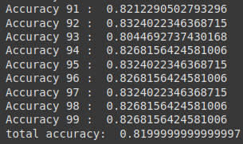

dataset: <https://www.kaggle.com/c/titanic/data>

```python3
# -*- coding: utf-8 -*-
"""titanic_survivor_prediction.ipynb

Automatically generated by Colab.

Original file is located at
    https://colab.research.google.com/drive/1F3uUqzXza3VyyOjcy3kYhUvma2N1ybyO
"""

import pandas as pd
import numpy as np
from sklearn.model_selection import train_test_split
from sklearn.ensemble import RandomForestClassifier
from sklearn.metrics import accuracy_score

# load dataset
df = pd.read_csv('train.csv')
df.head()

df.info() # see missing data
df['Survived'].value_counts() # see class balance

df.describe() # stats summary

df = df.drop(['Name', 'Ticket', 'Cabin'], axis=1)
df['Age'].fillna(df['Age'].median(), inplace=True)
df['Embarked'].fillna(df['Embarked'].mode()[0], inplace=True)
df['Sex'] = df['Sex'].map({'male':0, 'female':1})
df['Embarked'] = df['Embarked'].map({'S':0, 'C':1, 'Q':2})

X = df.drop('Survived', axis=1)
y = df['Survived']

total_accuracy = 0

for i in range(1, 100):
  X_train, X_test, y_train, y_test = train_test_split(X, y, test_size = 0.2, random_state = 42)
  model = RandomForestClassifier()
  model.fit(X_train, y_train)

  y_pred = model.predict(X_test)
  accuracy = accuracy_score(y_test, y_pred)
  print("Accuracy" , i, ": ", accuracy)
  total_accuracy += accuracy

print("total accuracy: ", total_accuracy/100)
```

