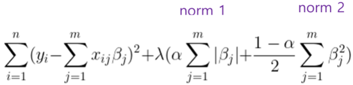
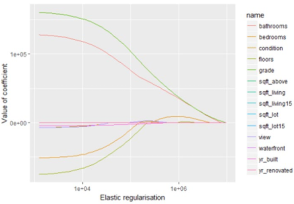

1. elastic net
- uses both L1 and L2 penalty terms
- can select more p than n

## See also
- [[python code|Python Implementation]]
- [[lasso regression|LASSO Regression]]
- [[ridge regression|Ridge Regression]]
- [[lasso vs ridge regression|LASSO vs Ridge Regression Comparison]]

reference:
- Gachon University - Machine learning lecture