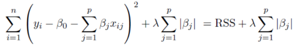
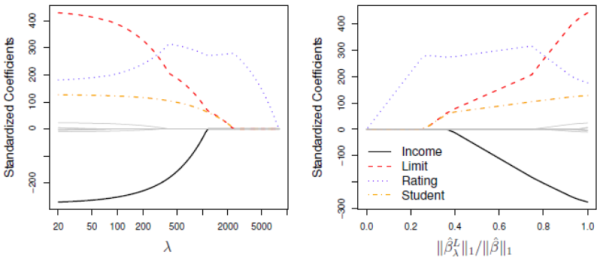

1. lasso
- Least Absolute Shrinkable Selector Operator
- uses L1 regularization => coefficient become zero more easily => feature selection
- minimizes

- limitations
   - large p, small n => selects at most n variables before it saturates
   - selects only one out of highly correlated variables group => lower accuracy

reference:
- Gachon University - Machine learning lecture