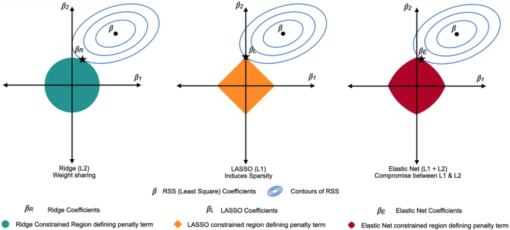

1. LASSO vs ridge regression
- LASSO produces simpler model
- LASSO generates more accurate predictions
- both have tradeoff between bias and variance
- cross validation can be used to determine which is better given a dataset

 reference:
- Gachon University - Machine learning lecture