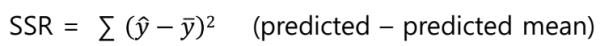
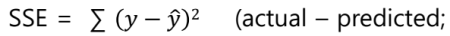
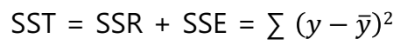
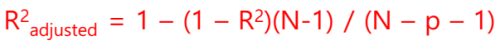

1. regression cost functions
- Sum of Squares due to Regression (SSR)

- Sum of Squares  of Error (SSE)

- Sum of Squares Total (SST)

2. R^2^
- R^2^ = 1 - (SSE/SST) = SSR/SST
- ranges from 1 to 0
- higher value means higher accuracy
- as features are added, never decreases => can set feature coefficient to 0 to ignore

3. improving regression models
- reduce variance => low test error - [1]
- filter out bad features

4. adjusted R^2^
- accounts for number of features (degree of freedom)

5. regularization
- constrains β coefficient estimates
- reduces variance 

notes
[1]: high variance => small changes in training data set leads to big changes in fitted model (overfitting)

reference:
- Gachon University - Machine learning lecture