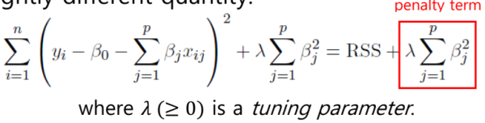
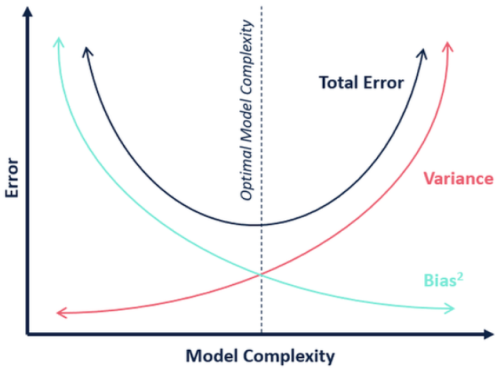
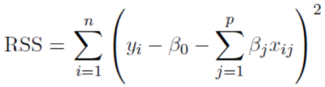
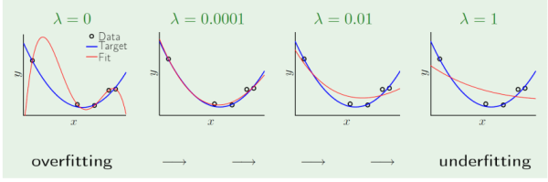
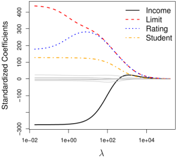
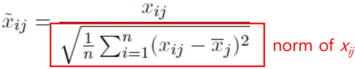

 1. ridge regression
- adds penalty term to cost function => force reduction of β
- uses L2 norm in penalty term => coefficients rarely become zero
- minimizes

- penalty term makes estimates biased but reduces variance
   - bias: difference between actual value and estimated value
   - variance: spread of estimated values

- limitations
   - retains features => complex to compute

2. RSS

RSS = |y - Xβ|^2^

3. λ

- a.k.a alpha
- determined through cross-validation
- as λ increases coefficients shrink towards zero

4. scaling
- coefficient estimates change significantly due to sum of squared coefficients term in penalty term
- standardize before applying ridge regression

reference:
- Gachon University - Machine learning lecture