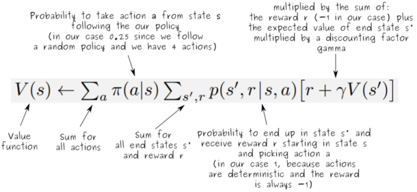

1. Markov Decision Process (MDP)
- environment provides information on current state
- agent determines which action to take
- action can obtain a reward signal from the environment => reinforcement
- state space: all information provided by an environment's state
- action space: all possible actions the agent my take within a state

2. MDP model
- S: set of states
- A: set of actions
- T(s,a,s') = P(s'|s,a): probability of transition from s to s' given action a
- R(s,a): expected reward for taking action a in state s

reference:
- IBM - reinforcement learning: <https://www.ibm.com/think/topics/reinforcement-learning>
- Gachon University - Machine learning lecture