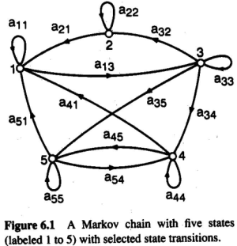
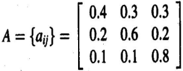
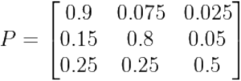
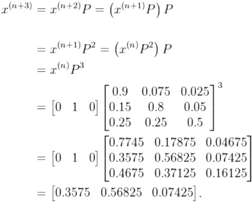

1. Markov Stochastic Process
- a random sequence whose probability distribution is determined solely by its current state
- observable state sequences lead to Markov chain model
- non-observable state sequences lead to Hidden Markov Model (HMM)

2. Markov Model
- N distinct states
- begins at t=1 at some initial state
- at each time step system moves to next step according to transition probabilities
- called finite (discrete) Markov Model

- probability of a sequence of states can be found by:
P(s~i1~ , s~i2~ , ..., s~ik~) = P(s~ik~ | s~i1~ , s~i2~ , ..., s~ik-1~)P(s~i1~, s~i2~, ..., s~ik −1~)
= P(s~ik~ | s~ik −1~)P(s~ik −1~ | s~ik−2~)...P(s~i2~ | s~i1~)P(si1)
- probability of state after k time can be found by the k power of the probability matrix P - [1]

3. walkthrough

rainy: 1, cloudy: 2, sunny: 3
P(X)? where X = (sunny, sunny, sunny, rain, rain, sunny, cloudy, sunny)

- calculate probability
P(3)*P(3|3)^2^*P(1|3)*P(1|1)*P(3|1)*P(2|3)*P(3|2)
= 1*0.8*0.8*0.1*0.4*0.3*0.1*0.2

4. Hidden Markov Model (HMM)
- state sequence cannot be determined from the signal sequence
- examples:
   - ball and urns:
      - 3 urns contain a known mix of balls
      - a ball is randomly drawn from an urn and shown to observer
      - the observer sees the sequence of balls but not the sequence of urns
   - weather guessing game:
      - what Bob does is determined by the weather
      - Alice has no definite information about the weather but knows the general trends
      - based on what Bob did Alice has to guess the weather
- inferences:
   - probability of observed sequence
   - probability of latent variables
- local maximum likelihood for best set of transition states can be derived using the Baum-Welch algorithm - [2]
- Viterbi algorithm obtains the probability estimates of the most likely sequence of hidden states

reference:
- Gachon University - Machine learning lecture

notes:
[1]:

if in state 2, probability distribution after 3:

[2]: it's a special case of the EM algorithm