1. Monte Carlo (MC) method
- apply repeated random sampling to obtain numerical results for difficult/impossible problems
- general approach:
   - define domain of possible inputs
   - generate inputs randomly from a probability distribution over domain
   - perform deterministic computation on inputs
   - aggregate results
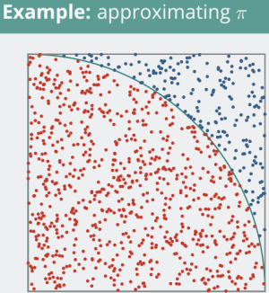

2. MC RL
- learns from episode of experience
- model-free (no knowledge of MDP transitions/rewards)
- learns from complete episodes 
- uses simple idea: value function = empirical mean return

3. MC RL definition
- sample episodes from experience under π
- when visiting state, increase visit counter and calculate mean
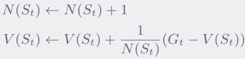 - [1]
- also possible to use exponential moving average
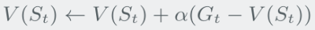
- can balance exploration and exploitation

4. MC RL policy iteration
- greedily improving policy over V(s) requires model:
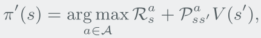
- greedy policy improvement over Q(s, a) is model-free: - [2]
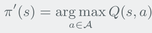

5. Q learning
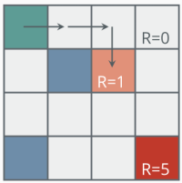
stuck at local minima

6. ε-greedy exploration
- simple idea to avoid local minima:
   - choose random action with probability ε (epsilon)
   - choose action greedily with probability 1-ε
- gives updated policy:
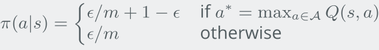

7. Greedy at the Limit with Infinite Exploration (GLIE)
- define schedule for exploration so two conditions are met:
   - continue to explore everything
	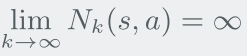
   - policy converges on a greedy policy
	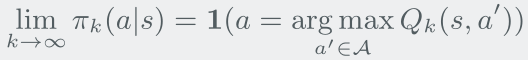

reference:
- <https://www.google.com/url?sa=t&source=web&rct=j&opi=89978449&url=https://cwkx.github.io/data/teaching/dl-and-rl/rl-lecture5.pdf&ved=2ahUKEwi99cWsoaiQAxWCsVYBHQtuNhwQFnoECB4QAQ&usg=AOvVaw1OS2PUtCnzYGNTCOr3Ecks>

notes:
[1]: 

x~k~ = G~t~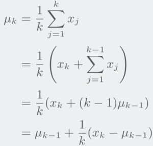: return
μ~k-1~ = V(S~t~): average(expected value) of returns

[2]:
V(s) only tells you how good it is to be in s following π
=> to decide which action to take, you need to look ahead: 
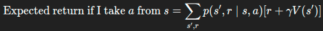
model of environment, p(s', r|s, a) is needed

Q(s, a) tells you how good it is to take a in s then follow π
=> already has expected future return of a in s: 
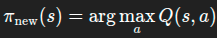
you already know how good each action is (on average), because it is implicitly encoded
despite environment model being in Bellman equation, it is not needed - [3]

[3]: 
instead of the model, samples are used to approximate expectation