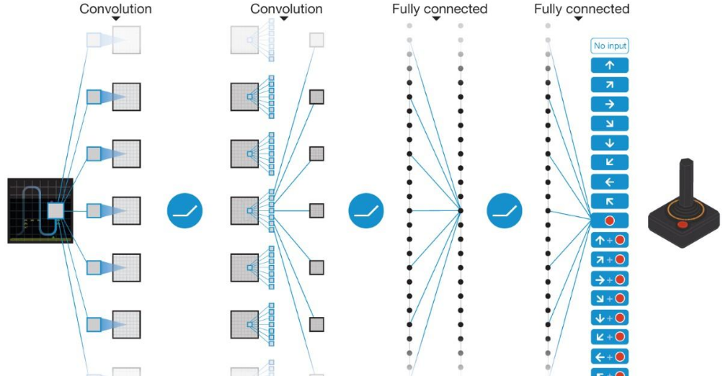
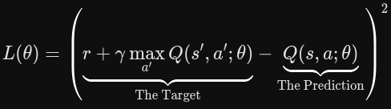
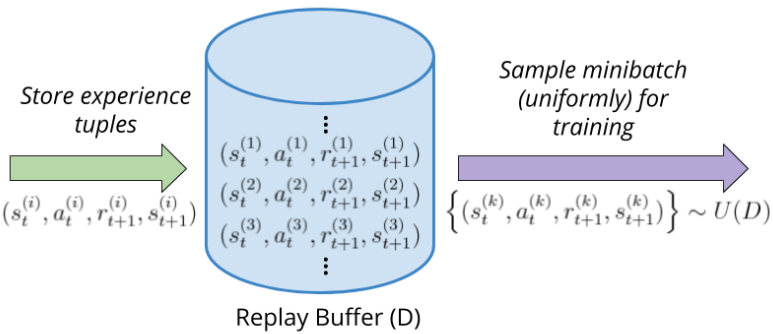
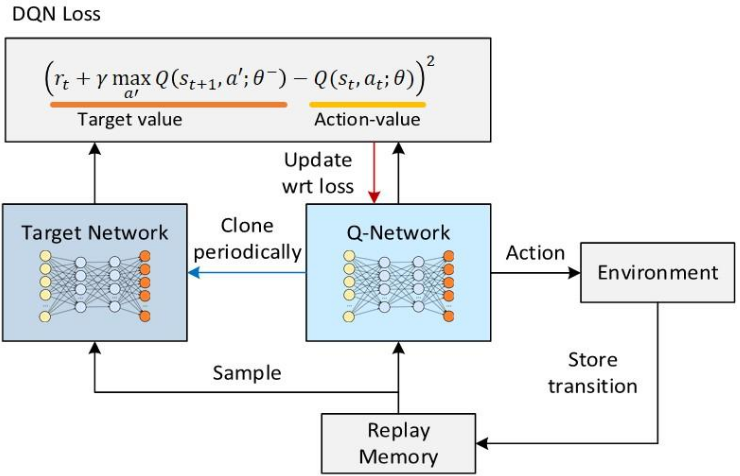

1. deep Q network(DQN)
- state(image pixel, etc) is input to Q values for each action
- uses CNN

2. limits
- correlation between data: experience data is strongly linked, violating deep learning assumption of i.i.d.
- moving target: target value comes from same model, changes during learning process

3. solutions
- experience replay:
   - store experiences and randomly extract from them
   - breaks chronological link between data

- target network:
   - separate main network that calculates Q and target network that calculates target
   - target network is updated periodically to suppress volatility

reference:
- 가천대 인공지능입문 Lecture 6 강의 자료 