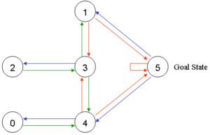
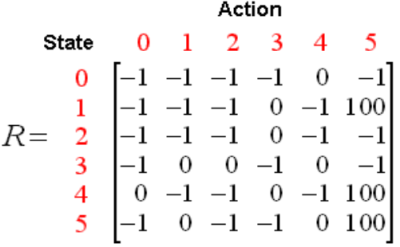
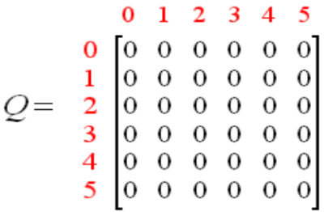
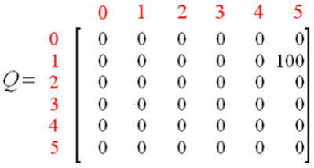
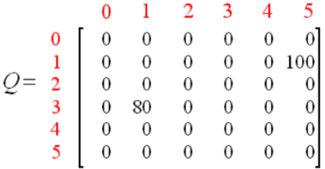
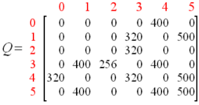
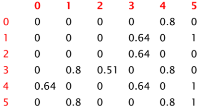

1. Q learning
- R matrix: reward matrix
- Q matrix:
   - represents memory of what agent learned
   - rows: current state of agent
   - columns: possible actions

2. Q matrix update process
- initialized to 0
- Q(state, action) = (1-Gamma)*Q(state, action) + R(state, action) + Gamma * Max[Q(next state, all actions)]

3. Q learning
- agent explores state reaching goal => episode
- each episode serves to train Q matrix

4. Gamma
- discounting factor
- between 0 and 1
- closer to 0 => consider immediate rewards
- closer to 1 => consider future rewards

5. Q learning walkthrough

- R matrix

- initial Q matrix

- gamma = 0.8, initial state is 1
- randomly choose next state (3 or 5)
- choose 5 and calculate Q values
Q(1, 5) = R(1, 5) + 0.8 * Max[Q(5, 1), Q(5, 4), Q(5, 5)] = 100 + 0.8 * 0 = 100
- state 5 becomes current state and episode finishes:

- 3 is chosen as initial state
- randomly choose next state (1, 2, 4)
- choose 1 and calculate Q values 
Q(3, 1) = R(3, 1) + 0.8 * Max[Q(1, 3), Q(1, 5)] = 0 + 0.8 *   Max(0, 100) = 80
- state 1 becomes current state

- randomly choose next state (3 or 5)
- choose 5 and calculate Q values
Q(1, 5) = R(1, 5) + 0.8 * Max[Q(5, 1), Q(5, 4), Q(5, 5)] = 100 + 0.8 * 0 = 100
- state 5 becomes current state and episode finishes (Q matrix doesn't change)
- repeat until converge:

- normalize Q matrix

- following highest value is the best sequence of events

reference:
- Gachon University - Machine learning lecture
- wikipedia - Q learning: <https://en.wikipedia.org/wiki/Q-learning>