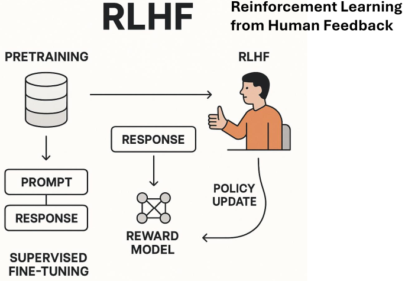

1. Reinforcement Learning from Human Feedback(RLHF)
- NLP + RL
- basis of modern ChatGPT

2. process
- prepare language model(actor): GPT model 
- train reward model(critic): trains based on which response got the best feedback from humans
- PPO fine-tuning(RL): reward model evaluates language model response, and this evaluation score is used by the PPO algorithm to update language model parameters

reference:
- 가천대 인공지능입문 Lecture 6 강의 자료 