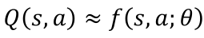
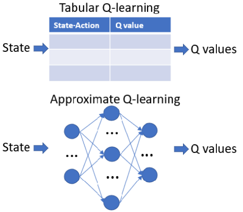
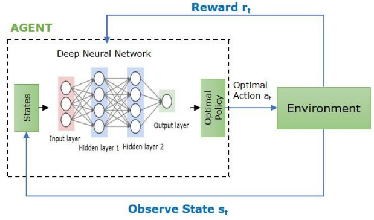

1. functional approximation
- Q learning limits:
   - curse of dimensionality: as state and actions increase, number of probable outcomes explodes
   - memory limit
   - sample inefficiency: most states are not visited and thus, empty
- defines function that outputs Q(action value) given state

- can infer values of unseen states from surrounding data; similar input gets similar output
- uses deep neural networks to approximate Q learning table

reference:
- 가천대 인공지능입문 Lecture 6 강의 자료 