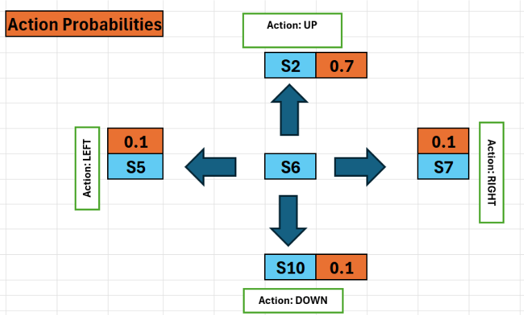
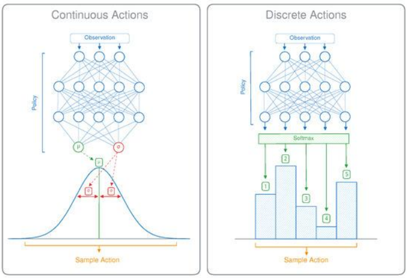
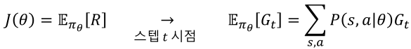
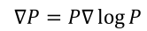
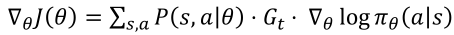
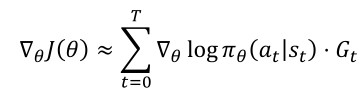

1. policy based RL
- DQN is limited to finite and discrete action space
- uses policy network that inputs state and outputs probability distribution of action
   - 𝜋~𝜃~(a|s): probability of a given s

2. output format
- continuous: print mean and standard deviation and sample action from resulting distribution
- discrete: use Softmax to get probability distribution of actions

3. policy gradient learning
- unlike cross entropy, try action, see reward, then fix probability
- objective function should maximize reward, not minimize loss

using log-derivative trick 

- single episode is used to collect sample data, which is used to approximate ideal gradient update

4. limits
- update delay: episode must finish for update to be applied
- high variance: learning is highly unstable and convergence is slow

5. solution - actor-critic structure
- actor(policy network): inputs current state and outputs action probability distribution (PG)
- critic(Q value network): evaluates what current action is worth (DQN)

reference:
- 가천대 인공지능입문 Lecture 6 강의 자료 