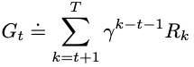
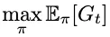
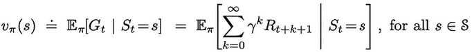
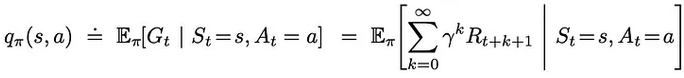
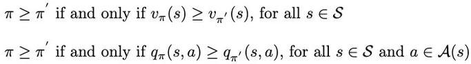
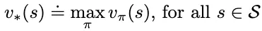
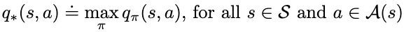
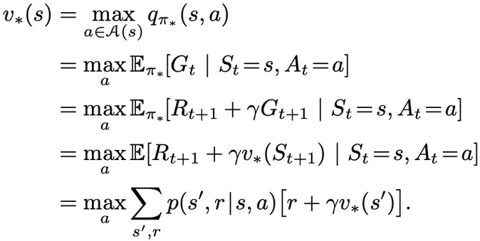
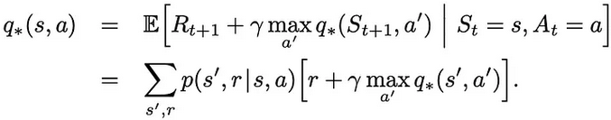
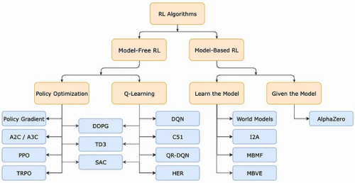

1. Reinforcement Learning (RL)
- focuses on decision making by autonomous agents
- learning takes place as result of interaction between agent and world
- applications:
   - resource management in computer clusters
   - traffic light control
   - robotics
   - web system configuration
   - chemistry
   - recommendations
   - bidding
   - advertising
   - games
   - deep learning
- algorithms:
   - Q-learning
   - Monte Carlo
   - State Action Reward State Action (SARSA)
   - DQN (Deep Q Network)

2. return
- return G~t~ is defined as

γ is the discount rate

3. policy
- represented as π (pi)
- mapping from states to probabilities of selecting each possible action
- used by agent to select action given state
- what we want to learn/optimize to maximize expected return
 - [1]

4. value functions
- estimates expected return for agent in a given state or performing a given action in a given state
- types:
   - state-value function: expected return when starting in s and following π
	
   - action-value function: expected return when starting in s, performing a, and following π
	

5. optimal policies and value functions
- optimal policy π* can be defined by value function:

- optimal policies share the same value functions, optimal value functions:
   - optimal state-value function v*
	
   - optimal action-value function q*
	

6. Bellman equation
- expresses the relationship between value of a state and the values of its successor states
- Bellman equation for v*
   - value of a state under an optimal policy must equal the expected return for the best action from that state
 - [2]

- Bellman equation for q*

- explicitly solving the Bellman optimality equation requires exhaustive search of all possibilities => not practical

7. RL approaches

- model-based vs model-free:
   - model-based:
      - agent has access to or learns a model of environment
      - model is used to make decisions
      - model is a function that predicts state transitions and rewards
   - model-free:
      - agent learns directly from experience and uses feedback to update internal policies or value functions
- policy-based vs value-based:
   - policy-based: agent learns policy directly
   - value-based: agent learns state/action-value function from which policy is derived
- on-policy vs off-policy:
   - on-policy: agent learns policy used to generate experiences
   - off-policy: agent learns different policy from the one used to generate experiences

8. Generalized Policy Iteration (GPI)
- almost all RL methods adhere to GPI paradigm
- find optimal policy by iteratively:
   - Policy Evaluation (E): learn value function under current policy
   - Policy Improvement (I): use value function to create improved policy

reference:
- IBM - reinforcement learning: <https://www.ibm.com/think/topics/reinforcement-learning>
- Gachon University - Machine learning lecture
- <https://medium.com/@hsinhungw/intro-to-reinforcement-learning-monte-carlo-to-policy-gradient-1c7ede4eed6e>

notes:
[1]: get π that maximizes expected output of G~t~ under policy π
[2]: 
because the system is stochastic, choosing an action doesn't determine the next state