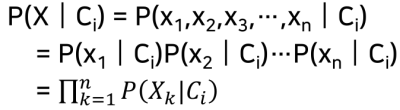
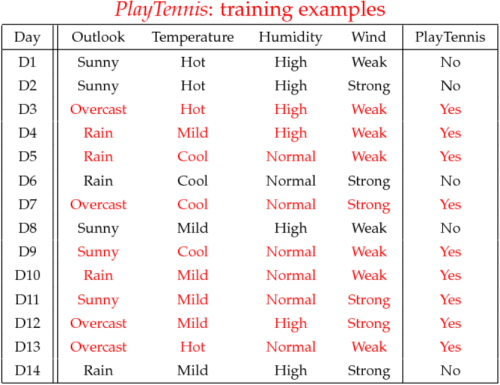
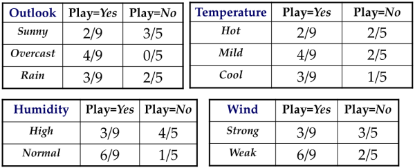

1. Bayesian classifier
- statistical method for classification
- supervised learning
- assumes Bayes rule as underlying probabilistic model
- get C~i~ where P(C~i~|X) > P(C~j~|X) for all j => Maximum a Posteriori (MAP) rule

2. Bayesian classifier elements
- D: set of tuples X
- X: n-dimensional attribute vector
- C: set of classes

3. naive Bayes model
- assume independence between features
- special case of Bayesian network that makes inference easier
- advantages:
   - returned probabilities show level of confidence
   - easy to implement
   - decent accuracy

4. naive Bayesian classifier

5. naive Bayesian classifier walkthrough

- construct frequency table

P(play=yes) = 9/14
P(play=no) = 5/14

- predict
x' =(Outlook=Sunny, Temperature=Cool, Humidity=High, Wind=Strong)
P(yes|x) = 2/9 x 3/9 x 3/9 x 3/9 x 9/14 = 0.0053
P(no|x) = 3/5 x 1/5 x 4/5 x 3/5 x 5/14 = 0.0206
x' => no

6. Laplace correction
- increase count of variables with 0 to 1 to prevent probability from becoming 0

reference:
- Gachon University - Machine learning lecture