1. Support Vector Machine (SVM)
- usage:
   - text categorization
   - image classification
   - bioinformatics
   - hand writing recognition
- adapted to regression
- advantages:
   - works well when margin of separation is clear
   - effective in high dimensional spaces
   - memory efficient
- disadvantages:
   - doesn't perform well for a large dataset
   - weak against noise
   - doesn't provide probability estimates

2. SVM illustration
- plot dataset
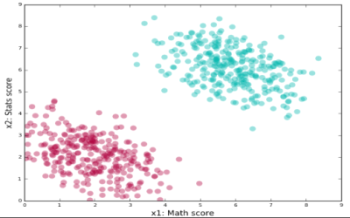
- find lines(planes) that correctly classify training data and pick the one with the widest margin - [1]
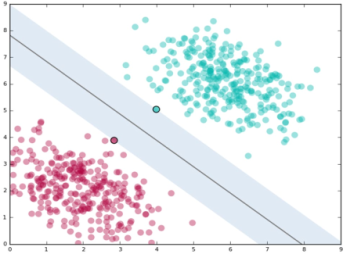

[1]: line is called separating line or classifier
closest data points that identify the line are called support vectors

3. soft margin
- more narrow margin
- allow data points inside margin
- tradeoff between wide margin and correctly classifying the dataset
- uses penalty parameter called "C"

4. C
- high value means high penalty for classification error
=> narrow margin, lower errors on training data
- value determined through cross validation
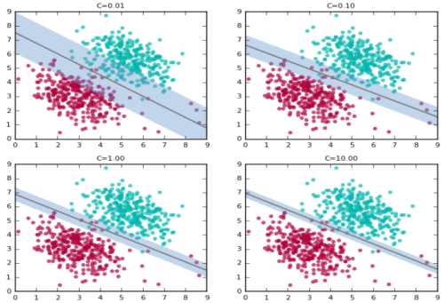

5. Kernel Trick
- use kernel (mapping or transformation) function to project dataset into higher dimension where it is linearly separable
- kernel is one of the hyperparameters

6. kernel trick illustration
- original data
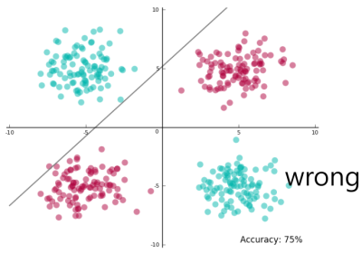
- after transformation
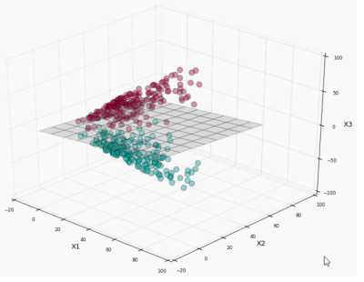
- map hyperplane back to 2d
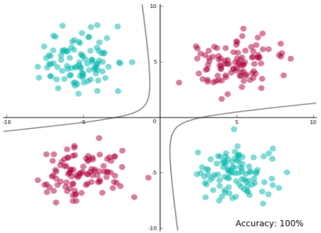
- with margins
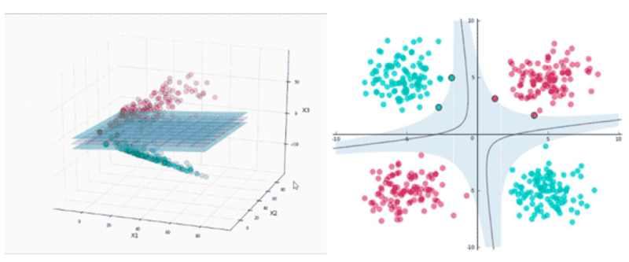

7. popular kernel functions
- linear kernel
- polynomial kernel with degree d
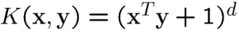
- gaussian kernel a.k.a Radial Basis Function (RBF) kernel with width σ
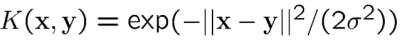
- sigmoid kernel with parameters κ and θ

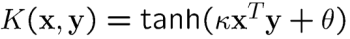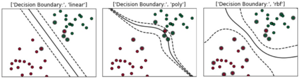

8. ploynomial kernel function illustration
- X: (-2, -1, 0, 1, 2) => X^2^: (4, 1, 0, 1, 4)
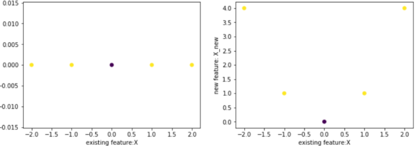

9. RBF kernel function
- gamma = 0.1, two centers (-1, 0) and (2, 0)
- X: (-2, -1, 0, 1, 2) => X1: (0.9, 1.0, 0.9, 0.67, 0.4) and X2: (0.2, 0.4, 0.67, 0.9, 1.0)
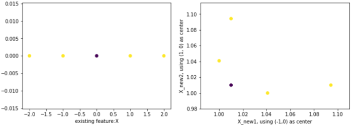
- effect of gamma on accuracy
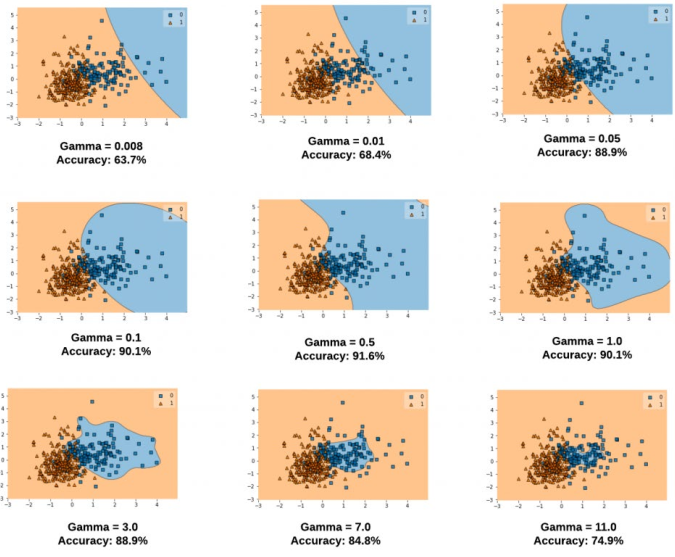

10. choices to make using SVM
- kernel
   - gaussian, polynomial is default
   - elaborate kernel used if necessary
- kernel parameters
   - gamma in Gaussian kernel
- optimization criterion (hard/soft margin, C)

reference:
- Gachon University - Machine learning lecture