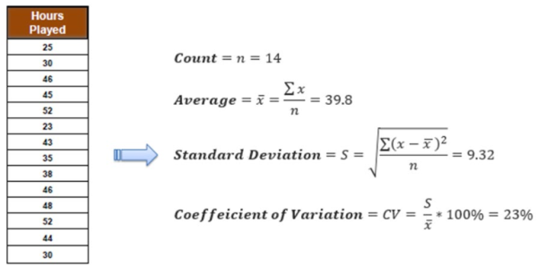
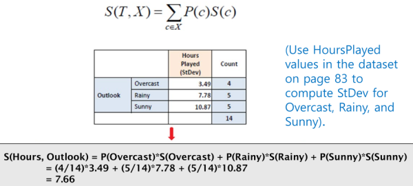
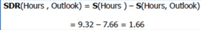
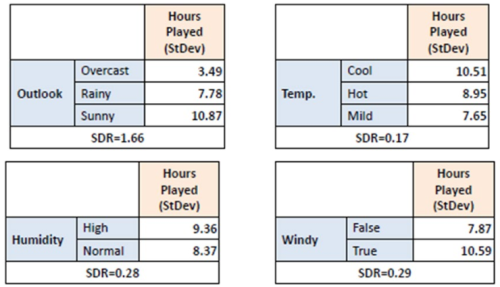
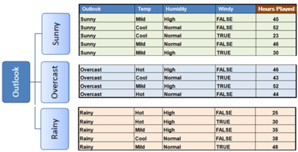

1. steps
- compute standard deviation for each attribute
- select one with largest Standard Deviation Reduction (SDR)
- Coefficient of Deviation (CV) is used as a termination criteria

2. illustration
- compute average, SD, and CV

- compute SDR

- split on largest SDR

- repeat 