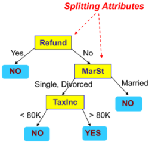
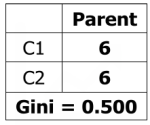
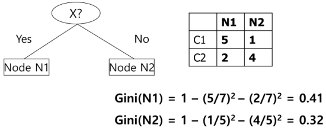
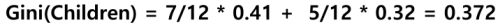
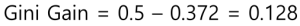
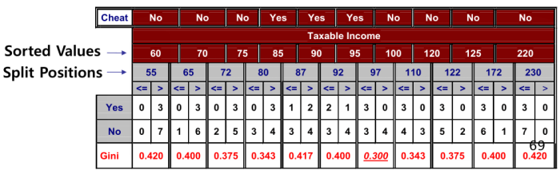
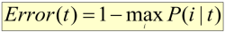
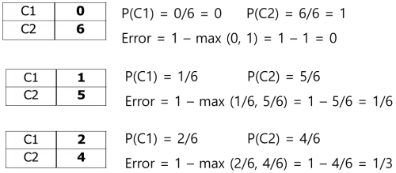

1. decision tree
- split based on attributes to reach decision

- advantages
   - inexpensive to construct for small datasets
   - fast at classifying unknown records
   - easy to interpret for small trees
   - can handle continuous and categorical variables
   - can handle classification and regression tasks
- disadvantages
   - error-prone with too many targets
   - expensive to train
   - greedy => no global optimization

2. selecting the best node split
- compute Gini index of parent

- compute Gini index of each partition

- compute weighted Gini index

- compute Gini gain

- select split with highest Gini gain

3. selecting best splitting value for continuous attribute
- sort attribute values
- choose split position as intermediate between two values
- compute Gini index for each position
- chose position with least Gini index

4. classification (miscalculation error)
- simpler than Gini index

- illustration

5. pruning
- pre-pruning
   - stop subtree construction at some nodes
   - set early-stopping conditions
- post-pruning
   - remove nodes bottom-up or top-down
   - if classification error does not become worse after removing subtree, replace subtree with leaf node

reference: 
- Gachon University - Machine learning lecture