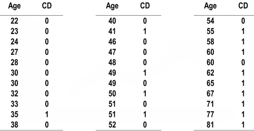
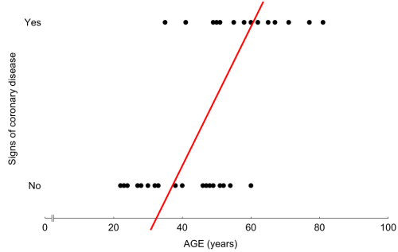
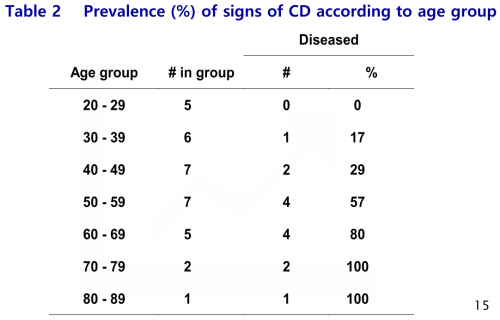
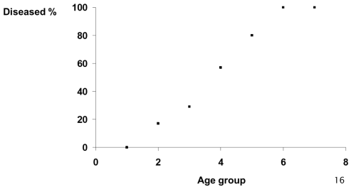
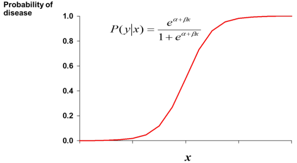
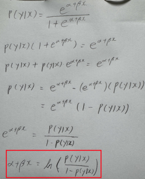

1. logistic regression
- used to fit a curve to data in which the dependent variable is binary 
- does not assume relationship between independent and dependent variables is linear
- does not assume dependent variable or error terms are distributed normally

2. when to use logistic regression

=> linear regression is not viable

- modify table

=> we can use SIGMOID function

3. relation to logits
- in logistic regression we seek a model of:
logit(p) = a + bX
- can reduce logistic regression to linear regression with odds

reference:
