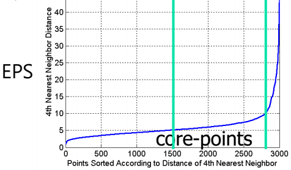

1. Density based clustering
- discovers clusters of arbitrary shape
- handles noise
- requires one scan of dataset
- requires density parameters:
   - ε: radius for neighborhood
   - MinPts: minimum number of points in given neighborhood
- methods:
   - DBSCAN
   - DENCLUE
   - OPTICS
   - CLIQUE

2. DBSCAN
- Density Based Spatial Clustering of Application with Noise
- core point:
   - more than MinPts within neighborhood
   - interior of cluster
- border point:
   - fewer than MinPts within neighborhood
   - in the neighborhood of core point
- noise point:
   - not core nor border point
- advantages:
   - resistance to noise
   - can handle different shapes 
   - number of clusters are determined automatically
   - can be supported by spatial index structures
- disadvantages:
   - can't handle varying densities or high dimensions
   - sensitive to parameters
   - input parameters can be difficult to determine

3. DBSCAN steps
- pick arbitrary data point P as first point
- mark P as visited
- extract points in neighborhood
- if there are more points than MinPts:
   - P is the first point of new cluster
   - all points within neighborhood are part of cluster
   - repeat for all points from above
- else: label P as noise
- repeat until entire dataset has been labeled

4. DBSCAN complexity
- Time complexity: O(n^2^)
=> can be reduced to O(n*log(n))
- Space complexity: O(n)

5. determine EPS and MinPts
- plot sorted distance of every point to it's kth nearest neighbor

for MinPts:4, EPS: 10

reference:
- Gachon University - Machine learning lecture