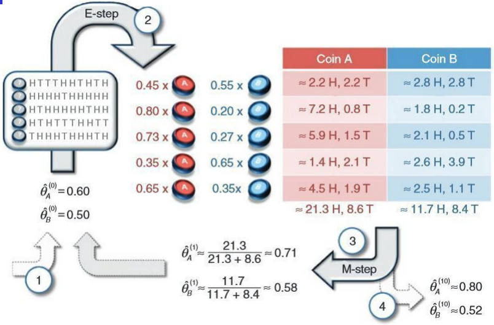
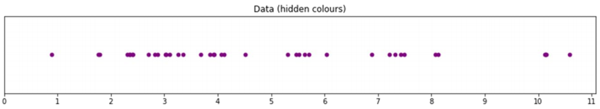
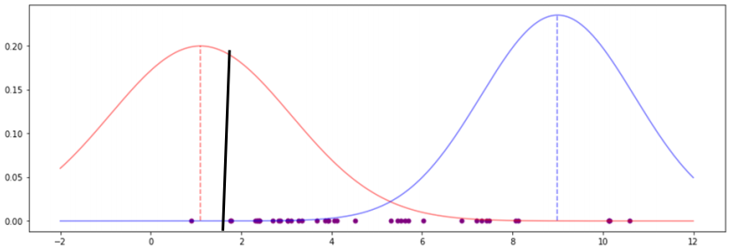
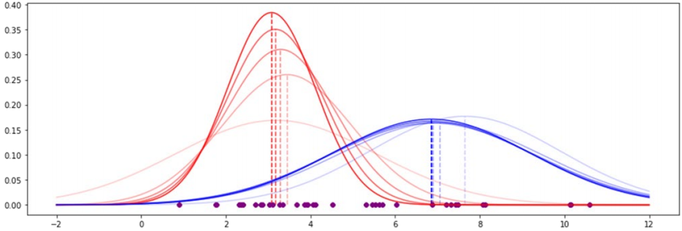
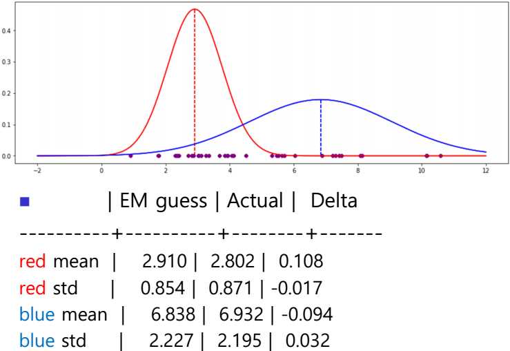
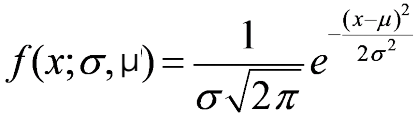
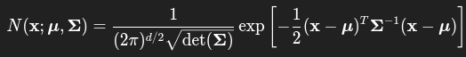
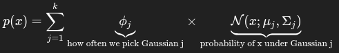

1. Expectation Maximization (EM) clustering
- elliptical clusters
- a.k.a. Gaussian Mixture Model
- soft clustering algorithm; assigns data to cluster with probability
- advantages
   - soft clustering allows elongated distribution of points
- disadvantages
   - computing parameters can take a long time
   - determining k is difficult
   - may end up with local minima

2. EM steps
- start with k initial cluster centers
- iterate until convergence
      - assign points to clusters based on probability
      - recalculate cluster center

3. EM algorithm
- method for performing Maximum Likelihood Estimation (MLE) of model parameters in the presence of latent(hidden) variables
- consists of:
   - expectation step: estimate values of latent variables
   - maximization step: optimize estimated parameters
   - repeat until converge

4. EM algorithm walkthrough
- 5 trials with 10 coin tosses each, using 2 coins
(1) H T T T H H T H T H
(2) H H H H T H H H H H 
(3) H T H H H H H T H H
(4) H T H T T T H H T T
(5) T H H H T H H H T H
- random initial guess for unknown parameters, probability of heads
p = 0.6, q = 0.5
- estimate the likelihood observation(trial) S comes from coin A
P(A|S) = P(S|A) * P(A) / P(S)
- equally likely to choose either coin => P(A) = 0.5
- P(S|A) follows binomial distribution
P(S|A) = p^5^ * (1-p)^5^
P(S|B) = q^5^ * (1-q)^5^
- P(S) is the probability of the observation
P(S) = P(S,A) + P(S,B) = P(S|A)*P(A) + P(S|B)*P(B)
- thus
P(A|S) = p^5^*(1-p)^5^) *0.5 / (p^5^*(1-p)^5^*0.5+q^5^*(1-q)^5^*0.5)
= 0.45
P(B|S) = 1 - 0.45 = 0.55
- expected number of heads from A = 5*0.45, tails = 5*0.45
- total number of expected heads from A = 21.3, tails 8.6
- from B = 11.7, tails 8.4
- estimate p and q again
p = 21.3/(21.3+8.6) = 0.71
q = 11.7/(11.7+8.4) = 0.58

5. motivating example for clustering
- create dataset
red mean = 3, blue mean = 7
red STD = 0.8, blue STD = 2

- guess mean and STD
red mean = 1.1, blue mean = 9
red STD = 2, blue STD = 1.7

- compute likelihood values using the Gaussian equation (i.e. probability density function for a normal distribution)
- convert likelihood value into weights
red_weight = likelihood_of_red / likelihood_total
blue_weight = likelihood_of_blue / likelihood_total
- compute new estimates 
- iterate

6. Gaussian Mixture Model (GMM)
- probabilistic clustering model using a mixture of k Gaussian distribution of data points
- regards each cluster as a normal distribution with parameters μ and σ
- Gaussian distribution in 1 dimension

gives probability of finding data point x in normal distribution with given mean and STD
- multivariate (n-d) Gaussian

- covariance matrix shows variance of each dimension, and relationship between inputs

7. GMM and EM
- regard each point as being generated by a mixture of Gaussians and compute that probability

- p(x) is the likelihood of x given the k Gaussian distributions
- EM is used to get Φ~j~, μ~j~, and Σ~j~

reference:
- Gachon University - Machine learning lecture