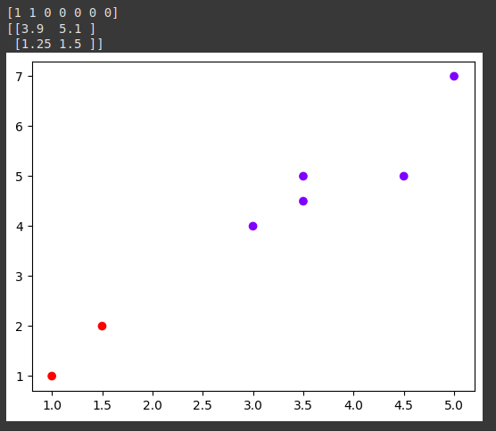

```python3
from sklearn.cluster import KMeans
import numpy as np
import matplotlib.pylab as plt

x = np.array([[1, 1], [1.5, 2], [3, 4], [5, 7], [3.5, 5.0], [4.5, 5.0], [3.5, 4.5]])
model = KMeans(n_clusters=2)
model.fit(x)

print(model.labels_)
print(model.cluster_centers_)

plt.scatter(x[:, 0], x[:, 1], c=model.labels_, cmap='rainbow')
plt.show()
```

