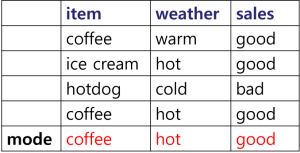
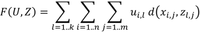
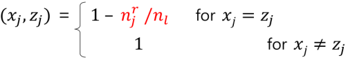
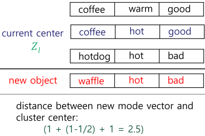

1. k-modes
- used for categorical data
- replace means with modes (most frequent value)

- centroids are represented by mode vectors

- minimize objective function

l: clusters
i: samples
j: attributes

2. process
- select k objects as initial modes
- repeat until no change
   - calculate distance between each object and mode vectors
   - assign objects to mode with shortest distance
   - select new mode for each cluster

3. distance function
- Hamming distance - number of different attribute values 
- can also use:

reference:
- Gachon University - Machine learning lecture