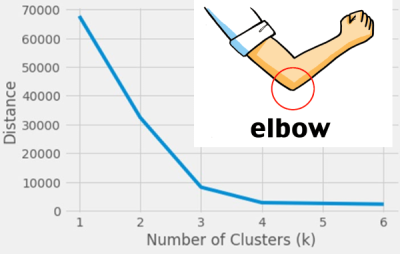
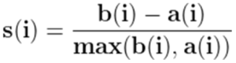
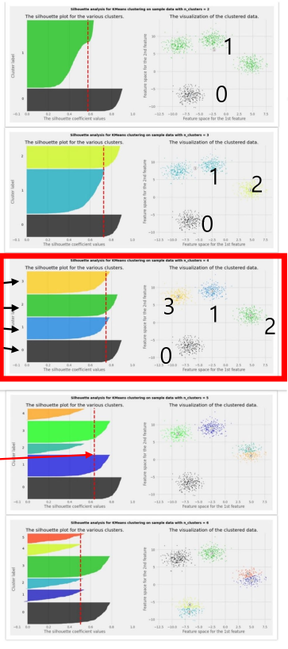
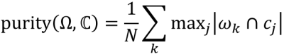

1. methods 
- elbow method
- silhouette index
- purity
- Dunn index
- Davies-Bouldin index

2. elbow method
- applied to results of K-means clustering
- find average distance of points in a cluster to its centroid and plot it
- pick k where average distance falls sharply

3. silhouette index
- applied to results of K-means clustering
- measure of how similar an object is to its own cluster compared to other clusters
- average of silhouette coefficients for all samples

a(i): average distance to all other points in cluster
b(i): average distance to all other points in other clusters

4. purity

- Ω is the set of clusters
- C is the set of classes

reference:
- Gachon University - Machine learning lecture