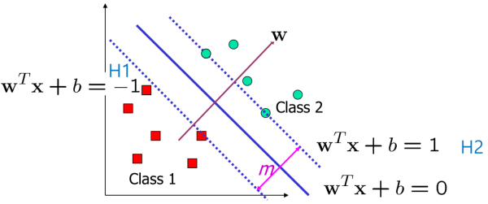

1. maximize margin

- *w* denotes vector of parameters β~i~
- *m* should be maximized
- m = distance between H2 and origin - distance between H1 and origin
= (1-b)/|w| - (-1-b)/|w| = 2/|w| - [1]
- when y~i~ ∈ {1, -1} is the class label
=> y~i~(w^T^x~i~ + b) >= 1 for all i

[1] check subnode