1. basis vectors
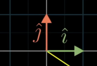
- i-hat (x axis), j-hat (y axis) => basis vectors of the xy coordinate system

2. linear combination
- linear combination of vectors:
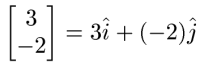

3. span

- span: set of all linear combinations

4. linearly dependent 
- at least one of the vectors can be expressed as a linear combination of the others
<=> linearly independent

5. linear transformation
- matrix vector multiplication
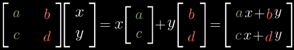
equivalent to moving i-hat to (a, c) and j-hat to (b, d), then seeing where (x, y) is moved to 
=> transformation

- matrix multiplication

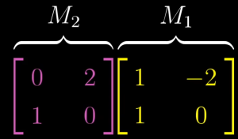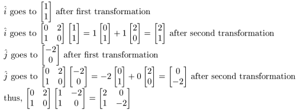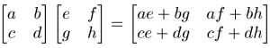

6. determinant
- the factor by which a linear transformation changes any area (volume for 3d)

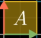
6 is the determinant

- if orientation of space has been inverted, determinant is negative

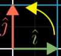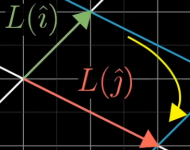
orientation inversion (2d)
use right hand rule for 3d. If after transformation, left hand has to be used, orientation inversion happened

- calculating determinant:
$$\det \begin{pmatrix}\begin{bmatrix}a&b\\c&d\end{bmatrix}\end{pmatrix} = ad-bc$$

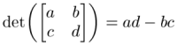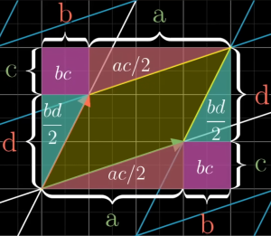

7. solving linear systems
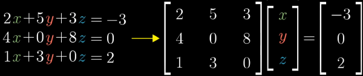

8. inverse matrices and identity matrices
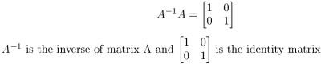
$$A^{-1}A = \begin{bmatrix}1&0\\0&1\end{bmatrix}$$
($A^{-1}$ is the inverse of matrix $A$ and $\begin{bmatrix}1&0\\0&1\end{bmatrix}$ is the identity matrix)

9. rank
- all vectors after transformation land in x dimension => x is the rank
- number of dimensions in the column space
- full rank => rank same as before transformation

10. column space
- set of all possible outputs

11. null space
- set of vectors that lands on the origin
- aka. kernel

12. nonsquare matrices
- 3x2 matrix
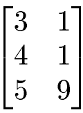
two columns mean two basis vectors
three rows mean landing spot is described with three coordinates

- transformations between dimensions