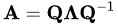

1. eigendecomposition
- factorization of a matrix into canonical form (matrix is represented in terms of eigenvalues and eigenvectors
- only diagonalizable matrices can be factorized

2. eigendecomposition of a matrix
- let A be a square n*n matrix with n linearly independent eigenvectors q~i~

- 

reference:
- wikipedia - Eigendecomposition of a matrix: <https://en.wikipedia.org/wiki/Eigendecomposition_of_a_matrix>