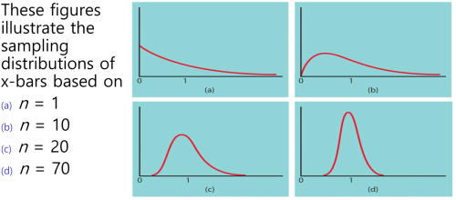

1. Central Limit Theorem (CLT)
- regardless of the population, the distribution of sample means tends toward normality

## Demonstration
- [[demonstration|Python Simulation Demonstration]]

reference:
- 가천대 - machine learning