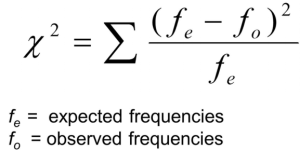
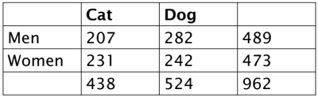
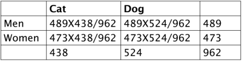
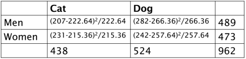
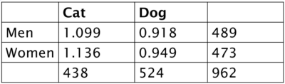
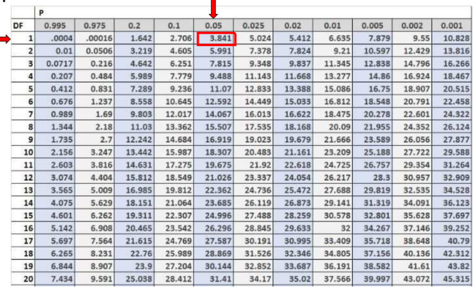
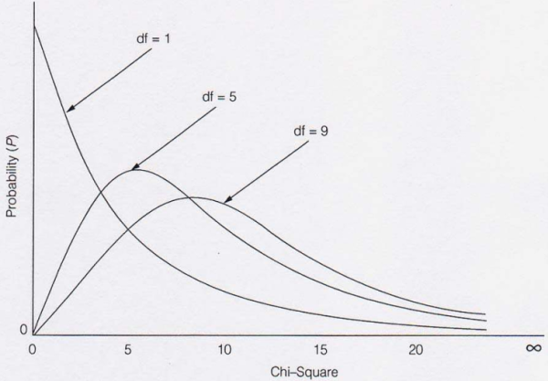

1. chi-square
- test for significant relationship between two categorical variables in bivariate table
- requires no assumption about shape of population distribution 
- requires random sampling
- formula

- limitations
   - doesn't give information about strength of relationship
   - sensitive to sample size
   - sensitive to small expected frequencies in table

2. illustration
- add rows and columns
 
- compute expected value(row total * column proportion) for each cell

- subtract expected from actual, square it, and divide by expected

- sum values
1.099 + 0.918 + 1.136 + 0.949 = 4.102 = chi-value
- get critical value or convert chi-value to p value

critical value = 3.841
or
chisq.dist.rt(4.102,1) => p=0.04283
- compare values
4.102 > 3.841 => calculated value > critical value
0.04283 < 0.05 => p value < level of significance 
=> reject H~0~

3. chi-square distribution

- positively skewed
- as df increases chi-square distribution becomes symmetrical

4. chi-square test in machine learning
- use to select features dependent on response
- can determine relationship between predictor categorical feature and response categorical feature

reference:
- Gachon University - Machine learning lecture