1. t test
- compares two averages and measures how different they are
- three main types
   - independent samples t test
   - paired samples t test
   - single sample t test

2. t score
- ratio between "the difference between two groups of sample data" and "difference within groups"
- larger t score means more difference between groups
=> more likely to be repeatable in population
- each has a p value associated

3. independent samples t test
- a.k.a two samples t test
- compare means of two different group samples
- null hypothesis: μ~1~ = μ~2~
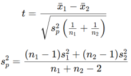
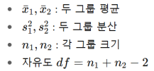

4. paired samples t test
- a.k.a correlated pairs t test, dependent samples t test
- compares means from same group sample at different times
- null hypothesis: mean of difference between paired samples is zero
- steps:
   - calculate difference between two datasets
   - calculate mean difference, d~m~ (difference between mean of each dataset)
   - calculate SD of differences, s~d~
   - calculate standard error of mean difference, SE(d~m~) = 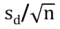
   - calculate t-statistic, t = d~m~/SE(d~m~)
   - use t-distribution table to find p value
   - test null hypothesis

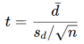
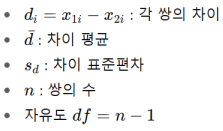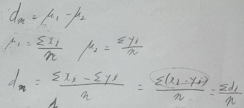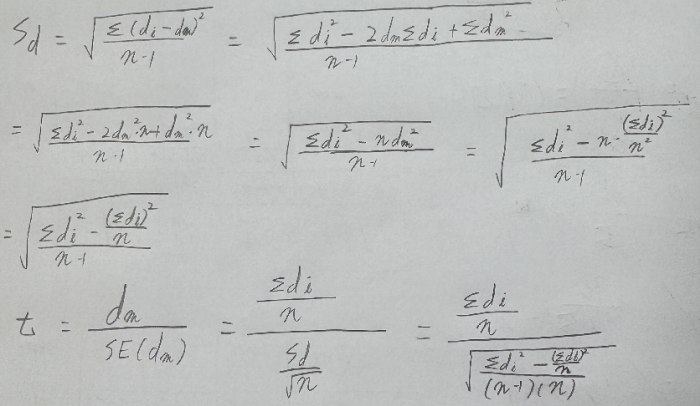

5. single sample t test
- compare mean of single group against known mean (population mean)

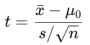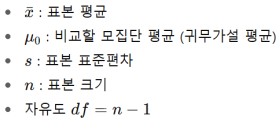

6. paired samples t test illustration
- calculate sum of difference (Σd~i~) and sum of squared differences (Σ(d~i~^2^))
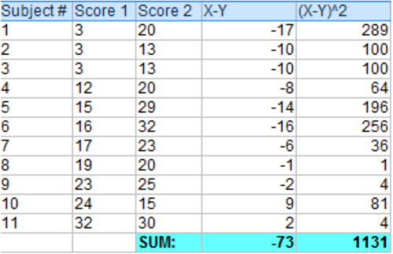
- calculate t
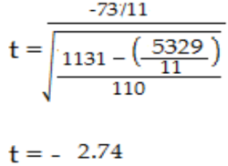
- calculate p value
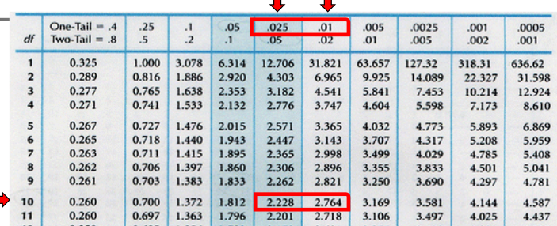
- p value is between 0.025 and 0.01
- reject null hypothesis

7. two-tailed vs one-tailed
- two-tailed: possibility of relationship in two directions i.e. significantly different
- one-tailed: possibility of relationship in one direction i.e. significantly less/more

8. paired samples t test illustration

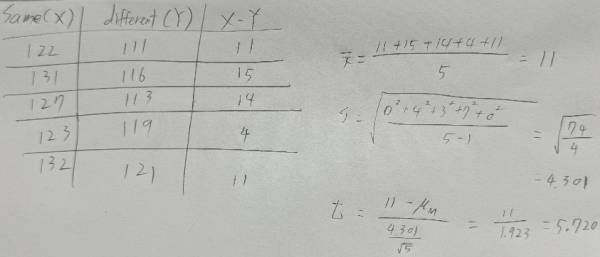
t = 5.72 
t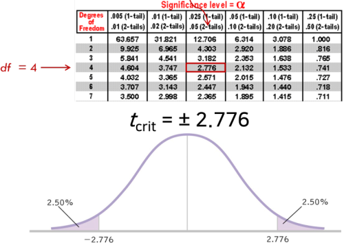~crit~ = 2.776
t > t~crit~
=> reject H0
X - Y, same room - different room should have a difference of 2.776 in either direction if to be 95% sure they are independent. But it has a difference of + 5.72, making same room significantly better than different room

9. t test in machine learning
- select learning model by comparing results of different learning models

reference:
- Gachon University - Machine learning lecture