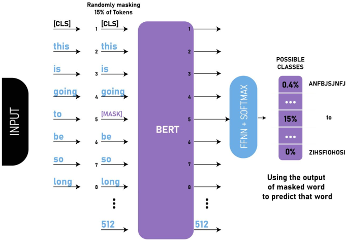
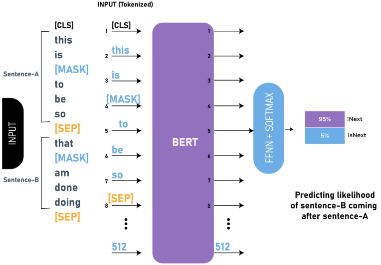

1. Bidirectional Encoder Representations from Transformers(BERT)
- uses attention to determine which words are related

2. core learning concepts 
- Masked Language Model(MLM): mask 15% of tokens and get it to predict them

- Next Sentence Prediction(NSP): show 2 sentences and get it to predict if it is the next sentence

reference:
- 가천대 인공지능입문 Lecture 5 강의 자료 