1. Convolution Neural Network(CNN)
- deals with ANN problems:
   - loss of spatial characteristics: 2d array image is flattened into 1d array, losing 2d meaning
   - parameter explosion: number of weights grows exponentially
- biological inspiration: brain combines lines, colors, silhouettes in "Local Receptive Field"

2. CNN core concepts
- sliding window: instead of viewing whole image, use kernel(filter) to scan image
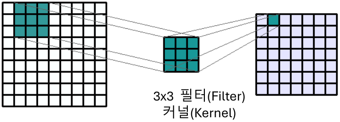
- kernel uses dot product
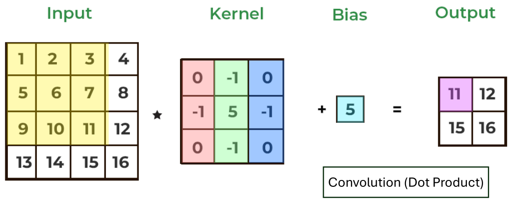
- why kernel is powerful:
   - parameter sharing: one kernel is used to scan whole image; reduces parameters exponentially
   - local connectivity: keeps image patterns to extract edges and lines
- using multiple filters:
   - one filter can only get one pattern; e.g. horizontal edges
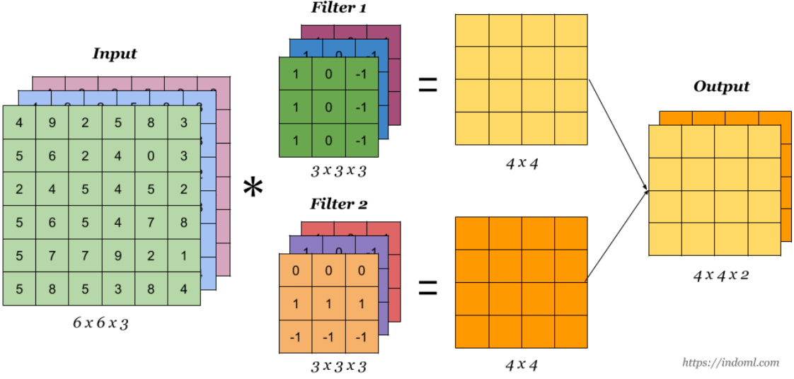
   - 2d feature map is created by summing all filtered values
- adding non-linearity with ReLU: f(x) = max(0,x)
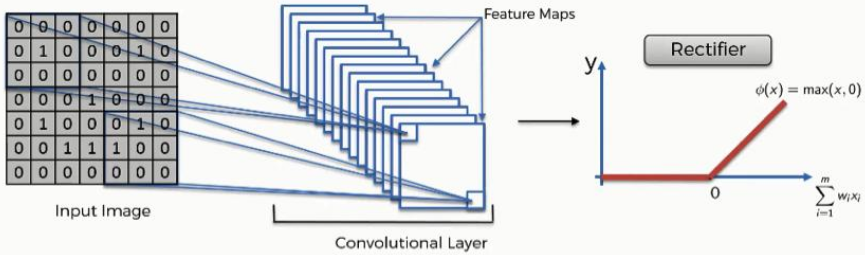
- downsampling with pooling: reduces spatial size of feature map
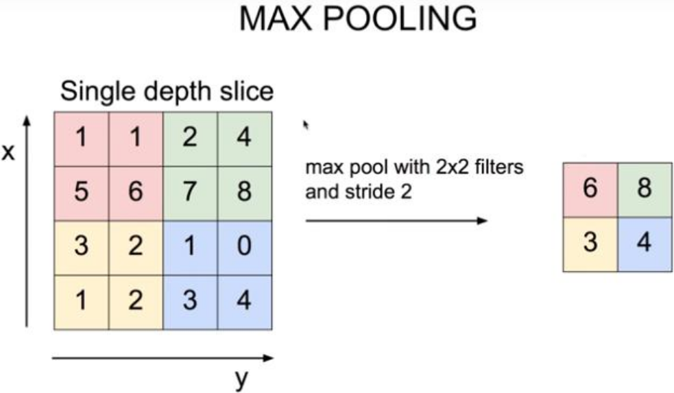
- stride: controls feature map size
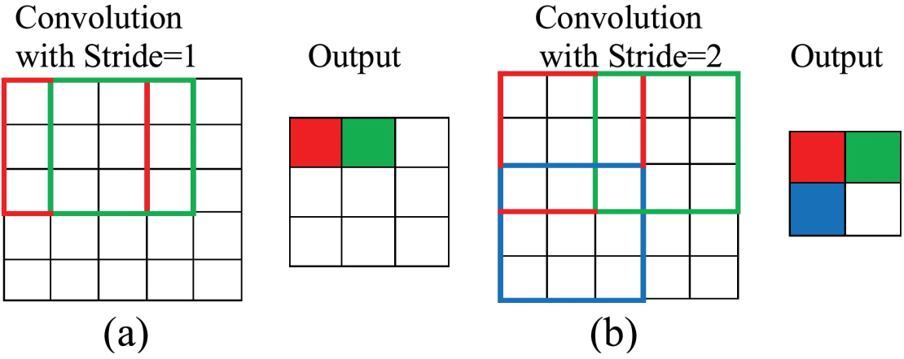
- padding: protects edge data
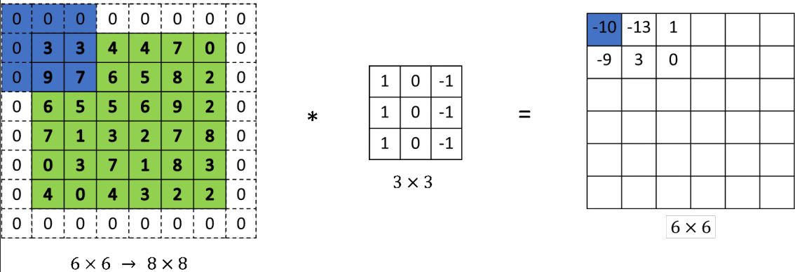

3. CNN architecture
- split into 2 parts:
   - feature extraction:
      - convolution > ReLU > pooling
   - classification:
      - flatten 3d feature map
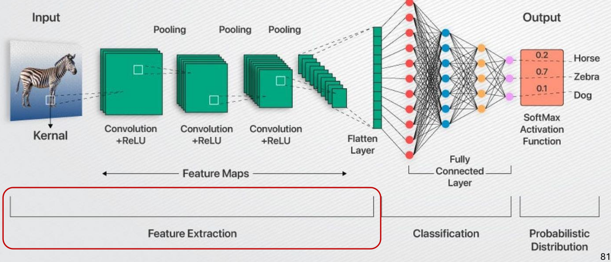

4. example code

```python3
import torch.nn as nn
import torch.nn.functional as F

class DeepCNN(nn.Module):
	def __init__(self):
		super(DeepCNN, self).__init__()
		self.conv1 = nn.Conv2d(in_channels=1, out_channels=32, kernel_size=3, padding=1)
		self.conv2 = nn.Conv2d(in_channels=32, out_channels=64, kernel_size=3, padding=1)
		self.pool = nn.MaxPool2d(kernel_size=2, stride=2)

		# --- Classifier ---
		# 64 channels * 7 rows* 7 columns = 3136
		self.fc1 = nn.Linear(64 * 7 * 7, 128)
		self.fc2 = nn.Linear(128, 10)

	def forward(self, x): # Input Shape: (Batch, 1, 28, 28)
		# [Block 1] Conv -> ReLU -> Pool
		x = F.relu(self.conv1(x)) # Size: (Batch, 32, 28, 28)
		x = self.pool(x) # Size: (Batch, 32, 14, 14)
		x = F.relu(self.conv2(x)) # Size: (Batch, 64, 14, 14)
		x = self.pool(x) # Size: (Batch, 64, 7, 7)
		# [Classification] Flatten -> FC1 -> ReLU -> FC2 (Output)
		x = x.view(-1, 64 * 7 * 7) # Size: (Batch, 3136)
		x = F.relu(self.fc1(x)) # Size: (Batch, 128)
		x = self.fc2(x) # Size: (Batch, 10)
		return x
```


5. localization
- predicts location of object as well as class
- uses boxes to predict location
- extra 4 values are output (x,y) for center of box (w,h) for width and height of box

6. object detection
- multiple objects inside image
- challenges:
   - quantity: multiple objects may exist
   - location: objects could be anywhere
   - scale: size and scale differ
- sliding window for checking each part of image is too slow
- You Only Look Once(YOLO):
   - divide image into SxS grid
   - each cell determines if it contains object center
   - if object center seems to be inside, determine what it is and the box attributes

7. YOLO concepts
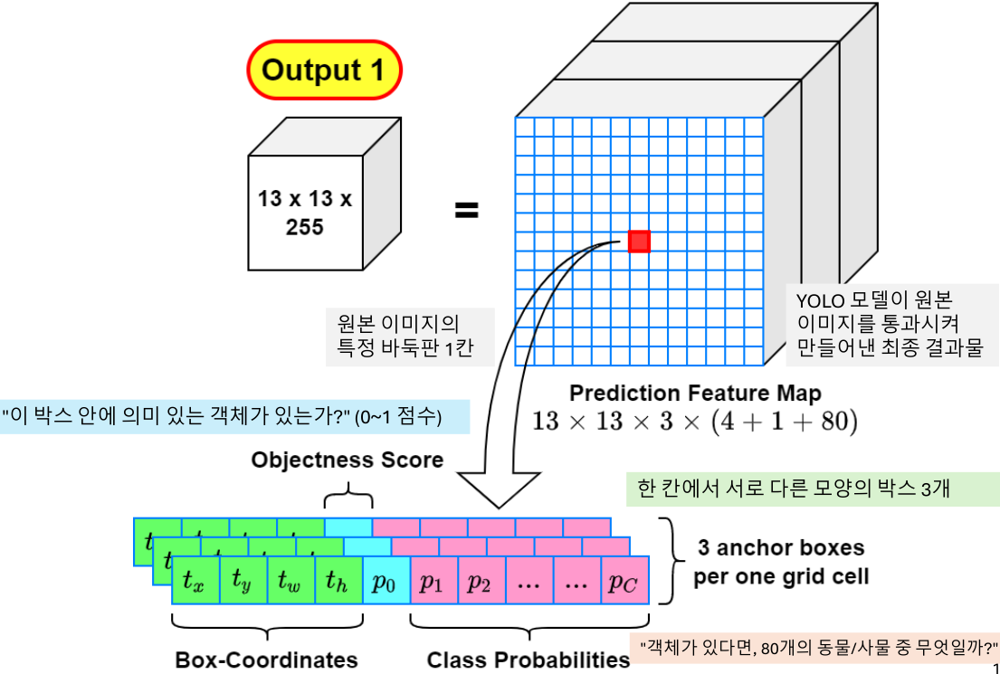
- anchor boxes:
   - anchor 1: tall
   - anchor 2: wide
   - anchor 3: square

8. semantic segmentation
- hourglass architecture
	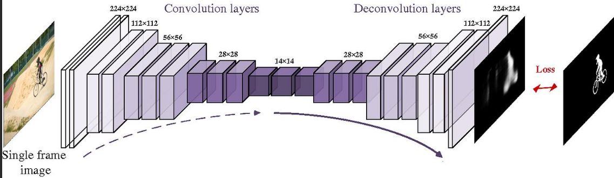
- retains spatial information to be able to accurately find pixels defining edge of objects
- output:
   - classification: vector of probabilities
   - detection: small tensor
   - segmentation: original height * original width * number of classes; argmax on depth to segment objects
- upsampling
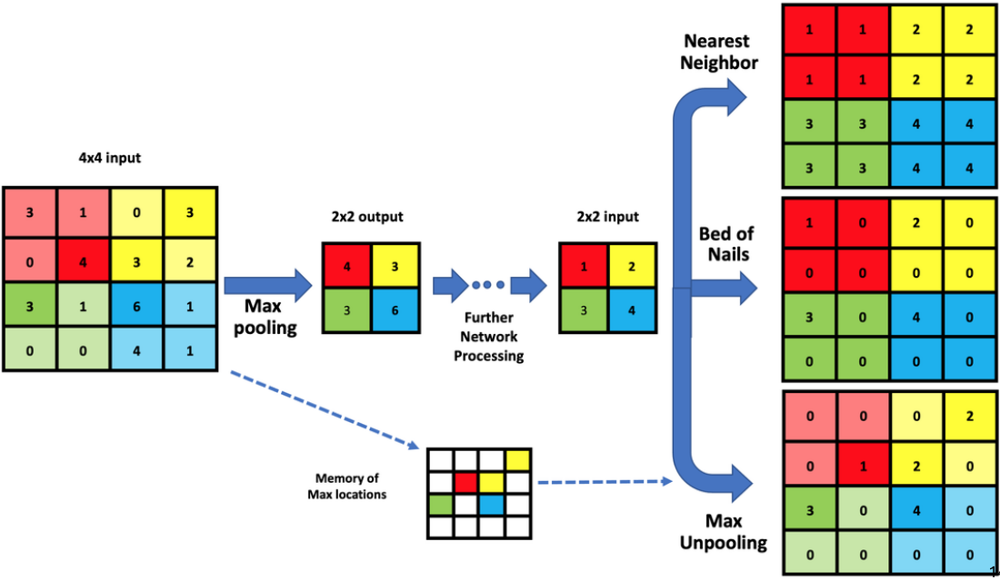
   - transposed convolution:
      - multiplies pixel with filters to broadcast pixel
      - learns weight for optimal broadcast 
		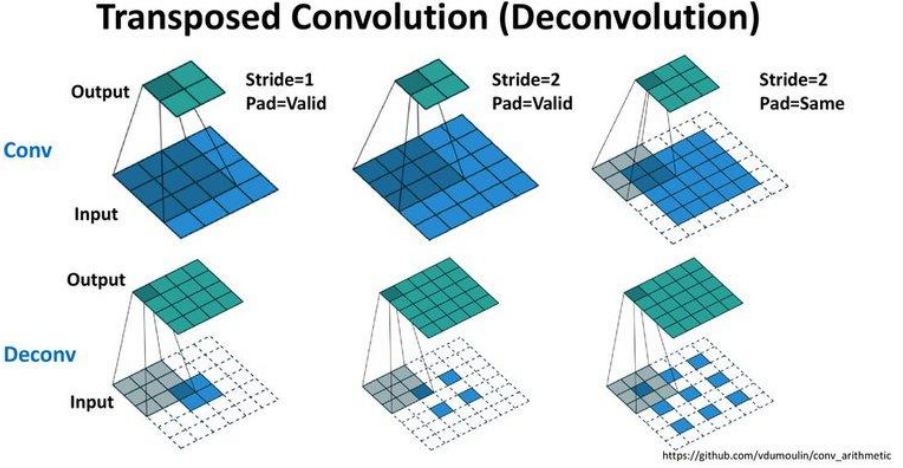

9. instance segmentation
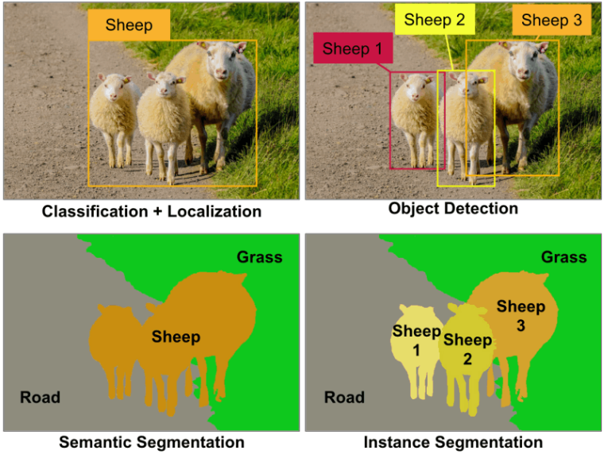
- semantic segmentation groups different instances of same object 
- use bounding boxes to find instances of objects and get edges within box
- Mask R-CNN:
   - 1. find boxes using object detection model
   - 2. create small segmentation network inside each box
   - 3. binary classification of pixels inside 